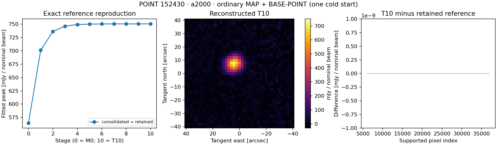

# Cold-start integration regression

**Pass: exact numerical reproduction on first attempt.** Source
`b47c13e1f5b745b94880218e347f77b4142686ff`, clean durable checkout;
`REGRESSION.json` binds the predeclared existing tolerances. M0 and T1–T10 MAP
and candidate planes all match exactly (maximum difference 0); deterministic guard,
fit/template/aperture, initial noise/covariance fields and endpoint uncertainty
records also match exactly. No allowance was weakened or second trajectory used.

| Stage | Peak (mJy/nominal beam) | East (arcsec) | North (arcsec) | Accepted pixels |
|---|---:|---:|---:|---:|
| M0 | 564.302659303 | 4.208131070 | 7.367744891 | 54 |
| T1 | 701.182017178 | 4.101642868 | 7.386031727 | 65 |
| T2 | 736.500685139 | 4.066253168 | 7.386544362 | 67 |
| T3 | 746.389403952 | 4.059218476 | 7.381755691 | 69 |
| T4 | 749.267844172 | 4.057262772 | 7.379938748 | 69 |
| T5 | 750.192959394 | 4.056555761 | 7.379341397 | 69 |
| T6 | 750.471626812 | 4.056376690 | 7.379107556 | 69 |
| T7 | 750.566406521 | 4.056298336 | 7.379015883 | 69 |
| T8 | 750.593383534 | 4.056274688 | 7.378995231 | 69 |
| T9 | 750.601272326 | 4.056267813 | 7.378989990 | 69 |
| T10 | 750.603601036 | 4.056265805 | 7.378988590 | 69 |

T10 conditional peak sigma = 6.170887305 mJy/nominal beam; template sigma =
7.881515020 mJy/nominal beam; aperture2 sigma = 2731.237195634
mJy/nominal beam arcsec². These are conditional model-based uncertainties, not a
full adaptive error law. The known shoulder-response limitation remains.

The pipeline took 117.213 s (111.893 s native stages); sampled native peak RSS
1.558 GB. Peak recorded stage storage 0.814 GB stayed below 3.323 GB ceiling.
One M0, one BASE trajectory, ten applications and one endpoint analysis were used,
including all attempts; the second-attempt allowance remains unused. The endpoint
emits the same retained NumPy matmul warning strings as the reference. Returned
conditional values are finite where identifiable and exactly equal to the prior
records; warnings are preserved in COLD_RUN.txt, not suppressed or treated as a new
scientific discrepancy. Native logs have zero error-level messages.

Isolation: cold-start.sb and ISOLATION.json record OS denial of old derived
operands and prior scratch code/build; original raw/tune/APT/telescope inputs,
declared environment and candidate remain readable. Two setup-only build option
corrections, an initial binary-path preflight typo and a denied-path regex probe
repair preceded science; they consumed no real-data attempts. No network transfer.

48 focused Python tests, 33 CTests, 124 upstream contract tests, 207 baseline-tool
tests (137 subtests) and full configuration preflight passed. Relevant projection,
subtract/restore, fresh PTC, replacement, guarded failure, high-coverage and
read-only relocation tests are included. Native CTest was focused, not the entire
unbuilt legacy suite. This is local AppleClang/Homebrew evidence, not Unity/Spack.

Cleanup removed 11,113 remaining native numeric files (533.939 MB); per-cycle
removals are separately recorded in compact/temporary-removals.jsonl. All saved
FITS and large YAML were losslessly compressed. The new compact bundle is 26.184 MB
and the existing 235 MB comparison was referenced in place. Original dependency
hashes remain unchanged. No native restart parent survives; reproduction explicitly
starts from originals. Reporting passes with all local_data access denied.
Source/configuration and compact results are durable Git history, not only scratch.
