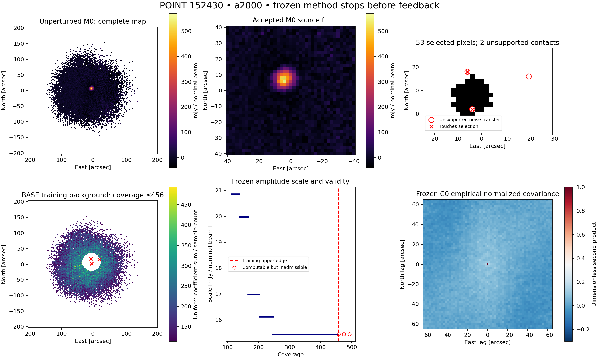

# Independent POINT 152430: frozen-method result

**The source and upstream processing passed, but the inherited feedback-admission guard stopped BASE-POINT at M0. No feedback applications ran. The requested policy comparison is unavailable, so the result is insufficient evidence about portability of the shoulder benefit or compact-response tradeoff.**

Observation 152430/0/2, source 1146+399, uses its own 152430/0/1 tune and a2000 networks 11/12. Selection preceded reduction and policy evaluation. It is a distinct acquisition approximately 3.5 hours after152389, in the same session; shared calibration errors may remain. The complete required local input set was reused in place: **0 download bytes**. The independent input review retains the stale auxiliary Oof label alongside authoritative Pointing metadata.

## Numerical result

| Quantity | Value | Meaning / units |
|---|---:|---|
| Fitted peak | 564.302659 | mJy/nominal beam above own fitted constant |
| Conditional guard σA | 6.695788 | mJy/nominal beam; frozen C0 reference, not validated source noise |
| Guard amplitude S/N | 84.277253 | Strict >10 criterion passed |
| East / north centroid | 4.208131 / 7.367745 | arcsec from FK5/J2000 expected origin |
| Major / minor FWHM | 9.591217 / 8.552165 | arcsec, gauge-safe sorted widths |
| Fitted constant | -8.380026 | mJy/nominal beam |
| Fixed template | 564.302659 | mJy/nominal beam; M0 unit-peak template, own constant removed |
| Aperture 1.0 × M0 major | 50189.274022 | mJy/nominal beam × arcsec²; fixed centroid/radius, not integrated flux |
| Aperture 1.5 × M0 major | 46680.498279 | mJy/nominal beam × arcsec²; fixed centroid/radius, not integrated flux |
| Aperture 2.0 × M0 major | 44497.894049 | mJy/nominal beam × arcsec²; fixed centroid/radius, not integrated flux |

All seven fit parameters are finite, neither width bound is active, and one optimizer attempt was used. Both networks completed every initial rank-10 PTC segment without a fit or application failure. The full 40 arcsec fit disk has valid MAP data. The fixed-template equality to M0 peak is expected because the template is constructed from this same least-squares fit. No independent source-recovery or calibration accuracy follows.

## Why admission stopped

The BASE noise model was learned outside the source-centered 3-major-FWHM mask. Its training coverage spans 114–456. The unchanged amplitude routine provides finite numerical continuation beyond 456 but marks that continuation invalid for candidate admission. Three valid MAP pixels in the feedback disk exceed that limit; two neighbor the selected source component under the inherited 8-neighbor rule. This is **unsupported noise transfer**, not missing MAP samples, failed PTC, a rejected source fit, or contact with the 40 arcsec outer boundary.

| East | North | Coverage | Touches candidate |
|---:|---:|---:|---|
| 4 | 2 | 475 | True |
| -20 | 16 | 493 | False |
| 6 | 18 | 458 | True |

The continued scale is 15.438984 mJy/nominal beam, but its validity remains false. The 53-pixel candidate (212 arcsec²) is retained as an **unapplied diagnostic** with `ready=false`. It was never projected or applied to the timestream. The common source guard can use the conditional computational covariance continuation; that does not make the extrapolated BASE amplitude valid for admission. No uncertainty at T10 exists because T10 was not reached.

## Full 15-cell execution matrix

| Policy | Branch | Status | Feedback applications |
|---|---|---|---:|
| BASE-POINT | REF | stopped at M0 | 0 |
| BASE-POINT | C-core-plus | unavailable | 0 |
| BASE-POINT | C-core-minus | unavailable | 0 |
| BASE-POINT | C-shoulder | unavailable | 0 |
| BASE-POINT | D-seed-shoulder | unavailable | 0 |
| CORR | REF | unavailable | 0 |
| CORR | C-core-plus | unavailable | 0 |
| CORR | C-core-minus | unavailable | 0 |
| CORR | C-shoulder | unavailable | 0 |
| CORR | D-seed-shoulder | unavailable | 0 |
| DIAG | REF | unavailable | 0 |
| DIAG | C-core-plus | unavailable | 0 |
| DIAG | C-core-minus | unavailable | 0 |
| DIAG | C-shoulder | unavailable | 0 |
| DIAG | D-seed-shoulder | unavailable | 0 |

The two other references were not launched under the required BASE-first / shape-freeze ordering. All 12 response/seed branches lack the BASE T10-derived shapes and their required references. No perturbed M0, injection raster, ideal-addition control, endpoint covariance, T1/T3/T5/T10 measurement or drift estimate exists. M0 is common physical input; unexecuted policy candidates are not represented as measured outcomes. No attempt was made to repair support, change thresholds, extrapolate validity, relax the boundary rule, swap observations, or launch a retry.

## Comparison with 152389 and importance

The retained 152389 assessment found an a2000 shoulder aperture discrepancy of −1951.1 brightness-area units for BASE, +100.890 for CORR and +100.971 for DIAG: −2.3021%, +0.11825% and +0.11885% of each full REF source aperture. These values remain historical evidence, not new-observation measurements or uncertainty denominators.

Because 152430 never entered feedback, it cannot determine whether supplemental aggregation helps, whether full covariance improves on DIAG, or whether compact-response/seed effects matter relative to measurement noise. Its concrete new finding is a portability limitation of the existing admission-validity rule on a bright, valid source. The three missing BASE noise-valid pixels cannot be called measured source loss or a whole-source flux error. Fixed thresholds remain uncalibrated for false-admission probability on this observation.

## Resources and reproducibility

Upstream RTC/CAL/AST/PTC: 21.832s; ordinary MAP: 8.138s. Complete upstream/M0 initialization: 30.505s. BASE admission attempt: 0.091s, with 0 feedback. Sampled largest native-process RSS: 1.557GB. Numeric libraries used 1 thread, upstream used 2 network workers, and BASE used 1 worker. No completed REF benchmark existed to schedule remaining workers.
The prospective campaign ceiling was 16.159GB. Science products reached 685,302,882logical bytes before closeout metadata. No download, full RTC/PTC ensemble, historical cache reconstruction, or Unity operation occurred. Cleanup accounting is in `cleanup/execution.json`; final compact size is separately recorded.

Inputs, exact source/binary/prospective identities, tested commands, frozen M0 operands, matrix, numerical tables, receipts and reviews are preserved in this bundle and the permanent repository records. Tests: 42 focused Python, 23 MAP/FRUIT native/reload, 8 PTC native, plus required configuration preflight; all passed. Independent preflight and stop-condition review are recorded. Numerical owners and production defaults remain unchanged.

**One next action recommended:** review the admission-noise validity contract for source pixels whose coverage exceeds the source-masked background range. This report proposes no new rule and executes no follow-up experiment.
