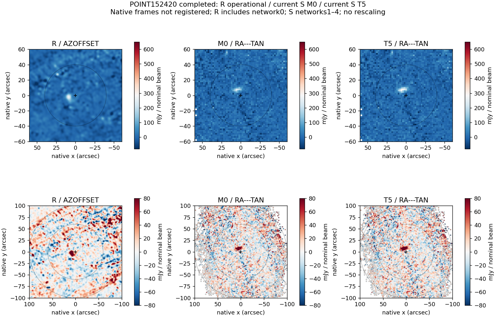
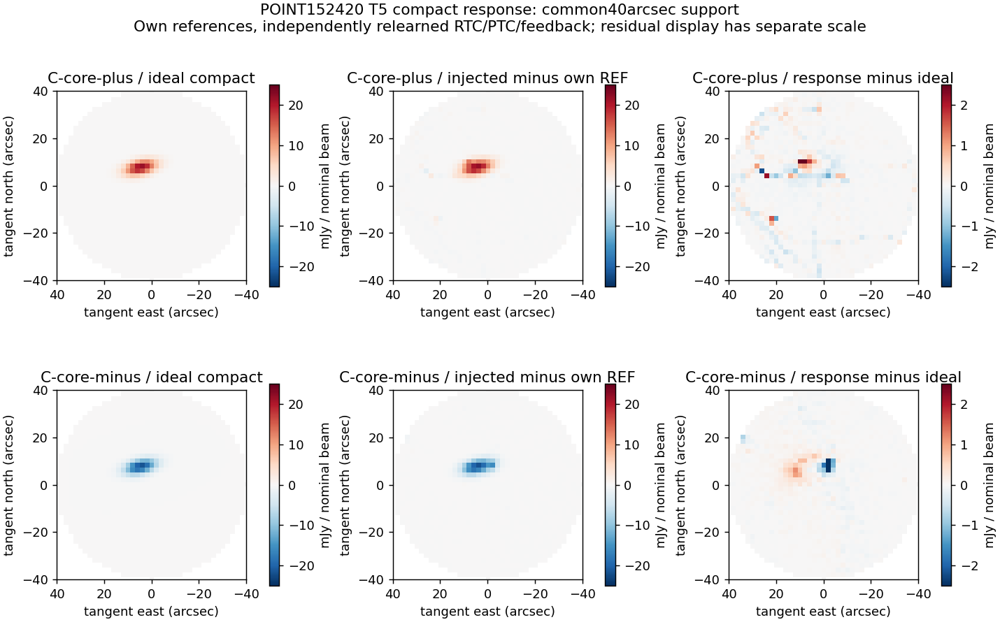

# POINT quality assessment completed — October 1, 2026

**Compact-source recovery improves through the successor's five feedback applications; improvement over the earlier processing reference remains not established.** The corrected 152420 run preserves the earlier scientific result to much better than its conditional measurement uncertainty. Support loss and residual contamination remain consequential. This bounded POINT milestone is closed without a further tuning campaign. OOF is the next development target, with the nominated local sequence and explicit execution blockers in the [completed handoff](../../handoff/POINT_TO_OOF_COMPLETION_2026-10-01.md).

The earlier [saved-product assessment](ASSESSMENT.md) and [prelaunch OOF handoff](../../handoff/POINT_TO_OOF_2026-10-01.md) remain unchanged because the completed batch binds their exact bytes. This completion note supersedes their pending-launch/current-152420 wording. Their calibration findings, historical controls, 152430 assessment and scientific limitations remain in force.

## Completion and exact scientific identity

All three roles completed on source `a6d2c4bb2b1ccce671c17ab29e723da3b57bc8db`, with zero unexpected error-level messages: B-REF, B-C-core-plus and B-C-core-minus. The ledger records **3 parents, 3 trajectories, 15 feedback applications and 3 endpoints**, with all 12 network RTC Apply receipts verified. No failed start, replacement, subset reduction, new 152430 run, shoulder reconstruction, Q/fixed11 run or OOF run occurred. The remaining ceiling is parked, not an invitation to spend eleven more starts.

The native route remains B: paired RTC/CAL support, cold M0, rank-10 observed-entry ALS with cap 500 and unchanged tolerance, fully re-solved warm updates, ordinary 2″ MAP, threshold-3 measured-brightness feedback within 40″, exactly five applications. Each T5 request is verified against its own **m4** candidate; m5 is not applied and cycle 6 does not exist. Original r and native input validity remain unchanged in the perturbations. Each arm relearns its RTC/PTC/feedback decisions; the M0 reference covariance/measurement context is shared and disclosed.

[Completed machine-readable metrics](results/completed/metrics.json) bind the status, ledger, execution/measurement receipts, timings, input shapes and response products. [Support details](results/completed/support.json) and per-network crossing files retain unavailable/rejected exposure explicitly. These calculations use saved products only and add zero observation starts.

## Current 152420 source measurement

| Quantity | Earlier executed B T5 | Corrected B T5 |
|---|---:|---:|
| Peak above fitted constant, mJy/nominal beam | 291.810314 | **291.818214** |
| Major × minor FWHM, arcsec | 10.980183 × 5.192742 | **10.980268 × 5.192811** |
| Supported science pixels | 9,351 | **9,351** |

The peak changes by **+0.007901 mJy/beam**. Across common-supported pixels the largest map change is 0.009039 mJy/beam; the standard deviation of the changes is 0.000368 mJy/beam. No science pixel is lost or gained. This is a corrected B-to-B comparison, not evidence of improvement over R.

The current endpoint conditional uncertainties are **14.1093 mJy/beam** for peak and **0.2735″ / 0.1220″** for tangent east/north centroid. The fitted centroid is (4.72899″, 7.40871″) relative to the commanded FK5 tangent origin. The M0-to-T5 centroid displacement is about 0.0553″. These are conditional covariance/feedback-stability results, not independent pointing accuracy, absolute-calibration errors or paired-comparison significance. Calibration/model-learning uncertainty is not included.

The three final fitted peaks are **291.8182 / 314.7384 / 269.4692 mJy/beam** for reference / positive / negative perturbation. The perturbations are known changes, not three independent estimates of the unperturbed source.



## Compact response and conditional uncertainty

The signed analytic amplitudes of the fixed physical raster family are ±22.327795 mJy/beam. Its discrete sampled peak is ±21.644485, so substituting the brightest raster pixel as the analytic amplitude would give the wrong gain. An independent evaluation of the recorded Gaussian parameters and prescribed taper reproduces the raster to 3.55e-15 mJy/beam. The completed response extraction separately verified native calibration-only projection against the own-reference ordinary-MAP ideal control.

Here `g_A = (fitted injected peak − fitted reference peak) / signed analytic input amplitude`. Both signed arms are retained:

| Endpoint | Positive g_A | Negative g_A | Conditional σ_A/abs(g_A), positive / negative (mJy/beam) |
|---|---:|---:|---:|
| M0 | 0.78372 | 0.79028 | 18.470 / 18.317 |
| T5 | **1.02653** | **1.00095** | **13.745 / 14.096** |

This demonstrates improved recovery of these compact perturbations through feedback relative to cold M0. It does not validate absolute calibration, remove additive bias, establish an infinitesimal derivative or demonstrate R/S sensitivity improvement. M0 uses its guard covariance; T5 uses its separately computed endpoint conditional covariance. There is no new noise ensemble. The displayed values are conditional **finite-response** uncertainty summaries, not empirically established precision or independent error bars on the gains.

The separately reported actual/ideal-fitted-increment ratios are 1.02341 / 0.99745; pixel-space gains are 1.02763 / 1.02368. They answer different questions and are not substituted for g_A. Relative response residual norms remain **0.17069 / 0.17848**, including shape and normalization discrepancies. Near-unity peak response does not imply perfect image recovery.

The positive perturbation changes 7,190 network-2 RTC state cells and 6,938 map-center cells, plus 29 state/map-center cells in network 1. Its HITS and NORMALIZATION differ from its own reference on 1,126 pixels; SCI_SUPPORT differs on 29 pixels. The negative arm changes 29 network-1 RTC state/map-center cells, five HITS/NORMALIZATION pixels, and no SCI_SUPPORT pixels. Both retain the full common 1,257-pixel source-fit disk. These adaptive changes explain why the two finite responses must not be averaged into a supposedly exact linear calibration. Maximum injected-versus-ideal fitted-centroid discrepancy is about 0.0521″ in one native component; no independent astrometric-accuracy claim follows.



## Background and support costs

Uninjected T5 still contains background structure that an injected-minus-reference image can cancel. In the predeclared 60–100″ annulus, native background standard deviation changes only from **29.4880 to 29.4570 mJy/beam** between M0 and T5; robust scatter changes from 24.5288 to 24.5459. This does not demonstrate background cleaning. The common kernel-safe domain contains only 321 pixels for the joint native/6″/12″ scale comparison, insufficient for a strong large-scale sensitivity claim. Descriptive tails, asymmetry, radial residuals, apertures and correlations are retained in the scorecard; none is promoted to calibrated significance.

For current B-REF, M0 and T5 have identical native operator/support. The saved-native audit finds:

- 2,069 input detector identities; 1,153 have any retained mapped samples.
- 15,528,129 originally paired-valid native cells; 8,163,715 retained MAP contributions across the observation.
- Within the commanded 40″ disk, **1,241,290 of 2,096,640 paired-valid cells are retained (59.2%)**. No retained source cell lies outside original paired validity in this audit.
- Source exposure falls from 17,175.67 to 10,168.65 **detector-seconds**, not elapsed seconds.
- Of 10,024 geometric crossing episodes containing original paired-valid samples, 6,157 retain some samples and 3,867 retain none. Episodes are defined separately per detector and physical run; they are not independent observations, and partial retention is not full recovery.

These losses describe the complete upstream/scheduling/eligibility path; they are not attributed solely to PTC or to the five feedback applications. Missing samples remain unavailable. The fully supported source-fit disk does not erase this exposure cost or establish absence of selection bias.

R remains the actual V2 operational reference, including network 0, with different atmosphere application, coefficients, projection and coverage decisions. Native supported area is 97,278 versus 37,404 arcsec² for R/S at 152420 and 98,094 versus 33,380 at 152430. This is an **operational support degradation**, not a registered common-sky pixel-loss calculation or a unique causal attribution.

## Disposition by anchor

| Measurement | 152420 | 152430 |
|---|---|---|
| Corrected successor reproducibility | Comparable at the measured map/fit scale; tiny correction versus conditional uncertainty | Saved applied candidates remain unchanged to roundoff; remeasured T5 retained |
| Compact response through feedback | Improved versus own M0 for tested ± perturbations; finite-response and shape limits above | Existing compatible executed B compact/shoulder evidence retained; no new run |
| Pointing accuracy / independent stability versus R | Not established: no registered matched R/S test or independently relearned subsets | Not established for the same specific reasons |
| Photometry / morphology fidelity versus R | Not established: different populations/calibration application/processing; no independent source truth | Not established; endpoint is 431.200 with conditional peak σ15.369 mJy/beam |
| Sensitivity / contamination versus R | Not established: no matched pre-RTC R response and insufficient common background comparison | Not established; saved S background scatter is larger, without a matched-response comparison |
| Operational map support | Degraded in supported area; retained exposure cost explicitly measured | Degraded in supported area in saved products |

The single geometry-supported alternating scan split remains predeclared and audited. Independent R/S subset stability is unavailable through the recovered legacy interfaces, not disproven by scan geometry. No conditional full-solution submaps are mislabeled independent reductions. Those gaps do not trigger a replacement POINT campaign.

The prior calibration audit remains unchanged: distinct beammap source flux/response lineages reconstruct the scale difference; no missing or duplicated downstream correction was found. Equal matched APT ancestry does not prove equal sample calibration, and neither beammap choice is independently established as the preferred absolute scale. No fitted map rescaling was used.

## Work, cost, preservation and verification

Raw-to-final outer-process wall times are **173.125 / 171.198 / 172.498 s** for REF / positive / negative. For REF, the initial raw-parent/PTC/MAP/guard/noise span is 89.619 s and the feedback trajectory is 81.522 s; spans are inclusive and must not be indiscriminately added. Aggregate sampled process-tree RSS is 3.060 / 3.234 / 3.216 GB. These are one execution per role on the local supplemental build, not a timing campaign or a Spack-backed R/S speedup.

The three numerical role wall times total **516.821 s**. Saved response extraction adds 101.173 s; completion scorecard/support arithmetic takes about 12 s separately. Preparation, cleanup and other outer-driver overhead are not inferred from these partial sums. Shared retained campaign storage is **20.072 GB**, below the 30 GB ceiling. The runner performed its bounded completed-role scratch release. Compact maps/metrics/figures/receipts and the remaining native support/response evidence are preserved; these are evidence, not resumable trajectory checkpoints.

Executed-source preflight: 1,321 enabled CTests passed (one pre-existing disabled test), 207 baseline-tool tests, 214 POINT-tool tests, config gate, native five-cycle contract, 14 transfer fixtures and five quality fixtures passed. Current completion validation reuses these exact execution bindings, independently checks all three final fits/response normalization/accounting, verifies original/retained support, and visually inspects both new figures. No application algorithm or native source changed in this closeout; no post-closeout native invocation is claimed. The independent exact-commit completion disposition is retained separately in the campaign's `COMPLETION_REVIEW.json`.

Reproduce this saved analysis before releasing its retained native evidence:

```bash
/Users/gwilson/tolteca/bin/python /Users/gwilson/.codex/worktrees/ptc-rank-response/citlali-refactor/validation/point_quality_2026-10-01/complete.py
```

It does not launch a reduction. Prelaunch files, original terminal status and executed source identity remain preserved. No new launch command is needed for POINT.
