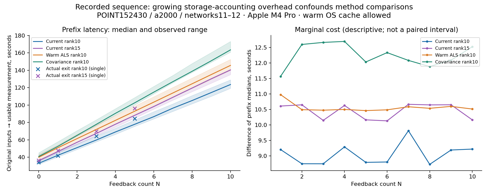
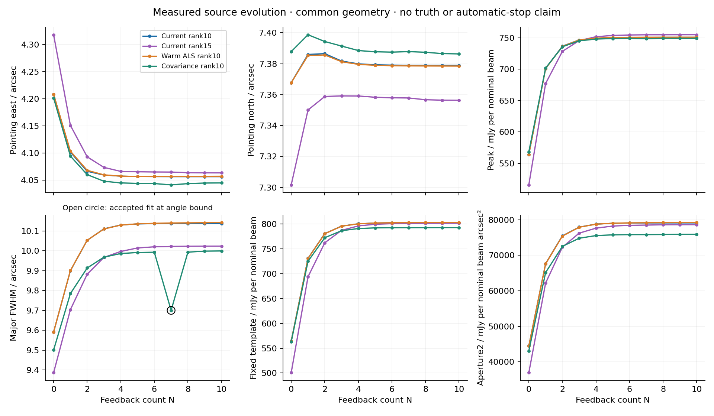
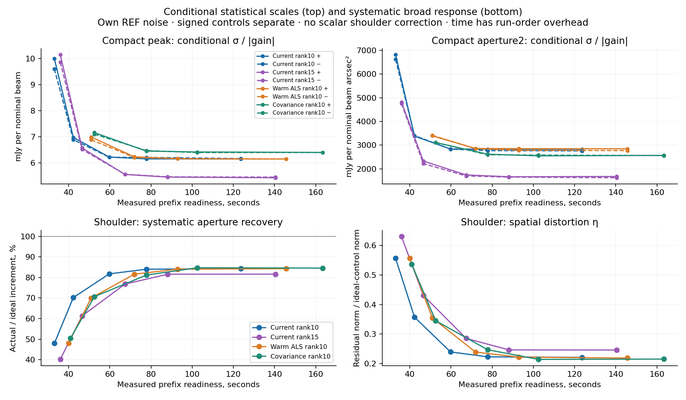
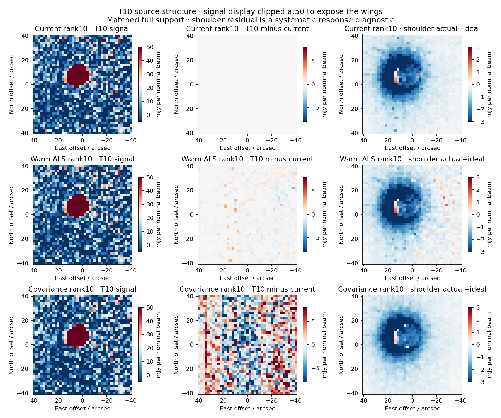

# POINT speed and the two PTC alternatives — 2026-09-27

**Keep the current rank-10 method as the reference.** The measured T10 exit median was **123.75s** (119.45–129.21), versus **145.80s** (140.16–152.66) for warm ALS and **163.63s** (160.96–173.36) for covariance. The shortest directly measured near-T10 checkpoint was current rank 10 **N=5:84.46s to exit** (one run;77.83s median prefix readiness). This is useful evidence for a future stopping study, not an automatic stopping rule.

**Timing limitation:** the unchanged driver scans the entire growing campaign directory twice around every native call to enforce storage bounds. Measured time outside native subprocess invocations grew strongly with run order. These are actual raw-to-result timings under the declared unchanged policy, but they cannot establish the intrinsic speed ordering of PCA methods. We do not subtract overhead and present the result as measured end-to-end speed. Phase C is deliberately unselected; no scientific retry or replacement was used.

26 trajectories,198 feedback applications,20 original-input parents and26 endpoint companions completed. Phase A strict rank 10/rank 15 regressions and every shortened prefix passed. Phase B completed all12 cells; support was preserved throughout. Scope is POINT 152430/0/2,a2000,networks11/12 only, on Apple M4 Pro14cores/48GiB, local AppleClang/Homebrew Release. This is supplemental local evidence, not Unity/Spack or full-instrument timing.

## Actual latency and acquisition duration

Bound native time axes span 64.06144s (network11;network12=64.05325s). Ratios below divide by the larger first-to-last span; including the final0.008192s sample changes ratios negligibly. Sample integration is not acquisition duration. Fresh process/original-input numerical state for every repetition; OS caches were not flushed, input verification may warm them, and the first use was retained. Network workers2,feedback segment workers1,numerical threads1,independent workloads1. No competing campaign builds/reports ran during timing.

| Method/rank | T10 ready median [range], s | Analysis median, s | Exit median [range], s | Exit/acquisition | CPU median, s | Peak aggregate RSS, GiB |
|---|---:|---:|---:|---:|---:|---:|
| current10 | 123.58 [119.24,128.96] | 123.64 | 123.75 [119.45,129.21] | 1.93 | 116.98 | 1.585 |
| current15 | 140.37 [135.00,141.05] | 140.46 | 140.59 [135.23,141.26] | 2.19 | 128.25 | 1.588 |
| warm10 | 145.56 [139.94,152.45] | 145.67 | 145.80 [140.16,152.66] | 2.28 | 131.27 | 1.586 |
| covariance10 | 163.42 [160.76,173.13] | 163.51 | 163.63 [160.96,173.36] | 2.55 | 146.78 | 1.586 |

CPU is aggregate child user+system CPU, not a percentage of14cores; tree RSS was sampled every50ms, not exact instantaneous peak. Exit follows completed endpoint publication; READY is an atomic accepted/failed map+measurement+state publication, independently observed by parent polling. Startup attempts include version checks and native launches and are retained in each LAUNCH record.

| Rank | N | Ready prefix median [range], s (3 runs) | Actual terminating analysis / exit, s (single) | Exit/acquisition |
|---|---:|---:|---:|---:|
| 10 | 0 | 33.07 [31.78,36.89] | 33.98 / 34.12 | 0.53 |
| 10 | 1 | 42.27 [40.36,46.35] | 41.57 / 41.68 | 0.65 |
| 10 | 3 | 59.76 [57.74,64.35] | 64.28 / 64.42 | 1.01 |
| 10 | 5 | 77.83 [75.48,82.83] | 84.36 / 84.46 | 1.32 |
| 15 | 0 | 35.92 [35.11,36.89] | 36.19 / 36.27 | 0.57 |
| 15 | 1 | 46.53 [44.83,47.35] | 47.44 / 47.59 | 0.74 |
| 15 | 3 | 67.33 [64.87,67.74] | 69.55 / 69.69 | 1.09 |
| 15 | 5 | 88.12 [84.88,88.66] | 95.98 / 96.10 | 1.50 |

N=0 executes no feedback; each terminating run executes exactly N applications and one endpoint. All-cycle prefix/marginal timing remains in machine-readable records. Candidate N1/3/5 companions are offline saved-map analyses after timing, not measured early-terminating commands; their costs are in CHECKPOINTS.json. Candidate N0 has its own guard noise but no extra full endpoint evaluation; unavailable N0 response-equivalent scales are left absent.

## What the stage measurements establish

| Representative first T10 run | Native feedback wall total, s | PTC fits inclusive, s | Initialization / eigen, s | J range / sum | Native adapter unattributed, s | Outside native subprocesses, s |
|---|---:|---:|---:|---:|---:|---:|
| current10 | 79.55 | 8.75 | 4.24 / 3.11 | 2–85 / 3037 | 46.49 | 2.73 |
| current15 | 80.95 | 9.83 | 4.23 / 3.09 | 2–80 / 2394 | 46.57 | 16.56 |
| covariance10 | 77.56 | 4.87 | 4.74 / 3.54 | 0–0 / 0 | 48.59 | 42.76 |
| warm10 | 72.47 | 0.60 | 0.02 / 0.00 | 2–35 / 354 | 46.52 | 30.36 |

PTC fit includes initialization and decomposition; these columns are nested, never additive. Native adapter residual is native wall minus sequential segment walls, MAP and final serialization/verification. It is not automatically RTC or I/O. Outside-native time is the instrumented call span minus measured subprocess-invocation walls; it includes storage accounting and bookkeeping. The two recursive storage scans per call and growing file population explain a strong run-order confound, but no separate scan timer was installed, so the causal attribution is explicitly an inference supported by code and timing, not isolated measurement.

Warm ALS reduces the first-run ten-cycle fitting cost8.75→0.60s and J sum3037→354, with2.76s predecessor authentication/loading. Covariance takes4.87s to learn and hasJ=0 by construction. Warm initialization therefore has a genuine measured native-kernel benefit; the full invocation does not demonstrate a net improvement under this campaign driver. Native adapter residual alone is46–49s across ten cycles. The unchanged conditional endpoint costs0.04–0.06s in first representatives; uncertainty analysis is not the bottleneck. Per-network RTC/CAL traces overlap and cannot be summed as critical-path wall. Full stage/initialization/projection/loading/subtraction/MAP/serialization/verification and CPU/startup records are retained.

PCA decomposition was only3.1s of the reference ten-cycle native feedback wall. This does not justify a third randomized/truncated solver now. The next optimization target should be accounting/provenance and the unattributed native adapter work, with scientific identity/support preserved.

## Source evolution and practical stability

All measurements use common physical aperture/template geometry and each method/rank’s own noise. Brightness is mJy per nominal beam; centroids and FWHM are arcsec; aperture2 is mJy per nominal beam arcsec². Fitted constant subtraction remains part of template/aperture values.

| Family | N | Peak | East / North | Major / Minor FWHM | Template | Aperture2 |
|---|---:|---:|---:|---:|---:|---:|
| current10 | 0 | 564.303 | 4.2081 / 7.3677 | 9.5912 / 8.5522 | 564.303 | 44497.9 |
| current10 | 1 | 701.182 | 4.1016 / 7.3860 | 9.8998 / 9.0279 | 731.003 | 67679.7 |
| current10 | 3 | 746.389 | 4.0592 / 7.3818 | 10.1106 / 9.2754 | 795.807 | 77944.7 |
| current10 | 5 | 750.193 | 4.0566 / 7.3793 | 10.1352 / 9.3063 | 801.989 | 79029.9 |
| current10 | 10 | 750.604 | 4.0563 / 7.3790 | 10.1376 / 9.3089 | 802.621 | 79135.2 |
| current15 | 0 | 515.716 | 4.3183 / 7.3017 | 9.3864 / 8.2520 | 500.774 | 36980.4 |
| current15 | 1 | 677.132 | 4.1510 / 7.3501 | 9.7037 / 8.8826 | 693.782 | 62205.8 |
| current15 | 3 | 745.419 | 4.0734 / 7.3592 | 9.9667 / 9.2213 | 787.301 | 76250.2 |
| current15 | 5 | 753.581 | 4.0653 / 7.3583 | 10.0142 / 9.2683 | 799.569 | 78241.1 |
| current15 | 10 | 754.723 | 4.0633 / 7.3564 | 10.0233 / 9.2821 | 801.668 | 78638.7 |
| warm10 | 0 | 564.303 | 4.2081 / 7.3677 | 9.5912 / 8.5522 | 564.303 | 44497.9 |
| warm10 | 1 | 700.839 | 4.1034 / 7.3854 | 9.9007 / 9.0272 | 730.653 | 67616.1 |
| warm10 | 3 | 746.340 | 4.0596 / 7.3814 | 10.1098 / 9.2738 | 795.661 | 77905.8 |
| warm10 | 5 | 750.266 | 4.0566 / 7.3790 | 10.1357 / 9.3052 | 802.044 | 79035.9 |
| warm10 | 10 | 750.786 | 4.0570 / 7.3785 | 10.1421 / 9.3089 | 802.983 | 79225.3 |
| covariance10 | 0 | 568.252 | 4.2017 / 7.3879 | 9.5007 / 8.4782 | 563.072 | 43131.4 |
| covariance10 | 1 | 701.669 | 4.0943 / 7.3988 | 9.7845 / 8.9686 | 725.069 | 65166.6 |
| covariance10 | 3 | 745.038 | 4.0478 / 7.3915 | 9.9679 / 9.2150 | 786.601 | 74818.8 |
| covariance10 | 5 | 748.691 | 4.0438 / 7.3878 | 9.9913 / 9.2389 | 792.270 | 75769.2 |
| covariance10 | 10 | 748.929 | 4.0448 / 7.3864 | 9.9991 / 9.2414 | 792.925 | 75925.4 |

| Family | Pointing | Peak | Template | Widths | Aperture2 |
|---|---:|---:|---:|---:|---:|
| current10 | 2 | 4 | 5 | 4 | 4 |
| current15 | 4 | 5 | 6 | 5 | 5 |
| warm10 | 3 | 4 | 5 | 4 | 4 |
| covariance10 | 3 | 4 | 5 | 8 | 4 |

These are earliest recorded N for which **all later** measurements stay within0.25 of the matching own T10 conditional sigma. Widths are sorted major/minor and matched to the corresponding final fitted-axis sigma, avoiding artificial axis-label swaps. Centroids require both coordinates. This is a descriptive plateau marker, not a new acceptance threshold, paired significance, accuracy claim or operational stopping rule. All-cycle cumulative physical/percentage changes remain available where scales are unsupported.

The covariance REF fit atN7 hits the existing angle bound and temporarily changes the fitted shape; the accepted guard allows this, and the result is retained rather than repaired or retried. It delays the width plateau toN8. Full fit/constrained diagnostics and elliptical second moments are retained.

For current rank 10, N5 peak differs from T10 by−0.411mJy/beam (−0.055%,0.067σ); template by−0.631 (−0.079%,0.080σ); aperture2 by−105.3 (−0.133%,0.039σ). Compact-plus peak/aperture gains atN3 are0.9947/0.9641; atN5,1.0031/0.9665; atT10,1.0034/0.9671. Shoulder aperture recovery still grows81.78%→84.02%→84.28% atN3/5/10. Thus brightness stability alone is insufficient; N5 is the earliest directly terminated checkpoint near the final compact and broad response in this observation. N0 is the fastest accepted result but retains substantial attenuation.

## Matched-rank controlled response and uncertainty

Each signed injection uses the exact retained raster once at the post-RTC/CAL, pre-PTC x boundary; r is unchanged. Each iteration subtracts its own model from its immutable branch parent, relearns, applies, restores the same operand and maps. Both candidate methods preserve rank,detector eligibility and complete map support. REF timing repeats are not independent astronomical-noise draws.

| Family | Compact sign | Peak gain / σequiv | Template gain / σequiv | Aperture2 gain / σequiv |
|---|---|---|---|
| current10 | + | 1.0034 / 6.150 | 0.9935 / 7.933 | 0.9671 / 2824.045 |
| current10 | − | 1.0011 / 6.164 | 0.9997 / 7.884 | 0.9916 / 2754.262 |
| current15 | + | 1.0039 / 5.431 | 0.9928 / 5.488 | 0.9638 / 1674.495 |
| current15 | − | 0.9994 / 5.456 | 0.9993 / 5.452 | 0.9955 / 1621.309 |
| warm10 | + | 1.0014 / 6.147 | 0.9921 / 7.955 | 0.9645 / 2844.007 |
| warm10 | − | 1.0013 / 6.148 | 0.9998 / 7.893 | 0.9909 / 2768.091 |
| covariance10 | + | 1.0023 / 6.401 | 0.9977 / 7.566 | 0.9838 / 2563.986 |
| covariance10 | − | 1.0025 / 6.399 | 0.9987 / 7.558 | 0.9864 / 2557.190 |

σequiv=own matching REF conditional σ/|actual-to-ideal gain|, only for supported positive compact gains and nonsevere spatial distortion under the retained rule. Plus/minus remain separate. These are conditional input-equivalent measurement scales, not empirical sensitivity, full adaptive uncertainty or paired p-values. No scalar correction is assigned to the shoulder.

| Family | Shoulder aperture recovery | Spatial distortion η | Actual raw aperture increment | Actual fitted-background increment | Ideal raw / background increments |
|---|---:|---:|---:|---:|---:|
| current10 | 84.28% | 0.2211 | 11287.3 | 465.5 | 14462.1 / 1622.5 |
| current15 | 81.62% | 0.2459 | 10830.4 | 364.5 | 14462.1 / 1640.1 |
| warm10 | 84.31% | 0.2189 | 11339.5 | 513.9 | 14462.1 / 1621.5 |
| covariance10 | 84.56% | 0.2153 | 11323.5 | 501.5 | 14462.1 / 1664.8 |

Warm T10 response-equivalent uncertainties are essentially unchanged: plus peak−0.04%,template+0.28%,aperture+0.71% against current rank 10. Its T10 peak/template/aperture change by+0.183/+0.362/+90.1, below0.05 matching control σ, but it is not bitwise the same optimizer solution. Covariance gives plus peak uncertainty+4.08% (worse),template−4.63%,aperture−9.21%; it also changes unperturbed T10 template by−1.21% and aperture by−4.06%, and narrows the major FWHM10.1376→9.9991arcsec. Its shoulder recovery is84.56% versus84.28%. These mixed changes do not establish a universally better astronomical result. Current rank 15 offers lower compact scales but worse shoulder recovery81.62%, as in the prior rank record.

At equalN, neither candidate has a measured raw-to-result speed advantage. At comparable achieved compact/broad checkpoint quality, warm N5 closely matches current N5 but recorded prefix readiness is92.84 versus77.83s; its plateau is no earlier. Covariance is not equivalent to the control’s source shape/extended measurement and has the N7 shape excursion. We do not convert faster kernel time into an unmeasured adjusted wall time or invent a numerical operational POINT deadline. No such deadline was supplied.

## Numerical and support evidence

All1,320 saved native segment records converge, preserve original eligibility and retain every admitted entry, with zero application failed times. Each trajectory uses six original segments per network; admitted detector populations are417(network11) and411(network12), with594 or610 scheduled rows per segment. Exact detector lists, original slot intervals, eligibility hashes, realized ranks and complete support-audit planes are in native-methods.json and SUPPORT records. Candidate map HITS,NORMALIZATION,SCI_SUPPORT,NORM_SUPPORT and WCS agree on the full grids, before common-domain response diagnostics. No lost coverage is hidden by a smaller comparison denominator.

Warm state is branch/run/network/segment/rank/scope-bound, immediately previous and converged; current means,coefficients,objective and full stopping criterion are recomputed. No cold rescue. Its REF projector differences from current REF span0.00190–0.43973 in Frobenius norm. Covariance differences span0.00539–1.98738; later maps have different residual operands, so these are method-state differences, not fixed-input equivalence tests. Signed full eigenspectra, pair-count distributions, objectives and native timings are retained.

At T10, summed observed-entry residual objectives are1.321089e11(current10),1.320973e11(warm10),1.336068e11(covariance10), and1.113727e11(current15), each over2,870,933 eligible entries. Corresponding detector-time residual RMS values are214.513,214.504,215.726 and196.960mJy/nominal beam. Full objective histories are retained per network/segment/cycle. Later residual operands differ, so lower objective is not a paired fixed-input or map-quality proof; covariance is not optimizing the same low-rank SSE.

Covariance pair overlaps span213–610 samples, above the rank 10 minimum11. REF eigen residuals are at most4.38e−15, below the declared100ε×detector-count tolerance. Negative eigenvalue mass reaches0.404% of positive power; it is retained, not clipped. Selected modes are largest positive algebraic eigenvalues, with current validity-aware coefficients. J=0 does not claim an observed-entry SSE minimizer. Complete-data PCA equivalence, masked NaN handling, indefinite covariance, unavailable overlap/rank, warm scope/mask/tolerance and dependency failures have focused synthetic tests.

No unexpected native error-level log lines were found. Existing NumPy matmul runtime warnings are retained in the logs and census; all saved accepted measurement vectors and supported conditional endpoint scales were checked finite. This check does not erase the warning or constitute platform-wide numerical qualification.

The peak recorded storage snapshot was17.51GB against a93.44GB allocation ceiling. Snapshots plus explicit reservations are not a continuous filesystem high-water measurement. Compact preservation removes only exact enumerated inactive detector-time scratch after verified durable commit and review.

## Disposition, provenance and reproduction

Phase C: **deliberately unselected**. One next bounded action: remove campaign-size dependence from storage accounting and measure the large adapter/provenance costs while preserving exact scientific results; then design fresh matched timing evidence before independent-observation qualification. No RTC change, further FRUIT-method work, automatic stopping, new observations/arrays, integration, push or production activation occurred.

Phase A science: e28f6630fffaba77f78fc2c2cb883c7345ad92f4, exact independent preflight pass. Its timing report was committed at b7746e3ca6f1615039a2b9d4a3aabe2df62a2a7f before candidate implementation. Phase B science:08f81382d96afb0aad6bc1ed40543322887729b9, tree09005e5f5d36be6ae00267e3341adab9ee080ac6, independent preflight pass. Both executables matched their clean source revisions. Original frozen tag/profile remain unchanged.

The small comparison records, maps, all-cycle measurements, native diagnostics, timing/configuration hashes, figures and manifests are preserved locally. Redundant repeat arrays are unnecessary for reporting. Reporting scripts read saved maps/measurements; no original-input processing, new endpoint ensemble or native solver is run. Extraction of basis diagnostics happened before native cleanup, and its machine-readable result is retained. See [reproduction](REPRODUCTION.md) for exact saved-only commands, tests, cleanup and review boundaries.

## Closeout

Final independent review passed at cec7917ef57ac37ed48fceffec33bc95a32cd78a with
explicit timing/local-environment limitations and no severity findings. Compact
preservation163.8MB is committed. The exact244,212-file native scratch plan
(13.22GB logical bytes) was reverified and removed; all31protected input hashes
remain unchanged. See [review](FINAL_REVIEW.md), [cleanup](CLEANUP.json), and
[saved-only reproduction check](REPORT_ISOLATION.json). No follow-on was executed.
