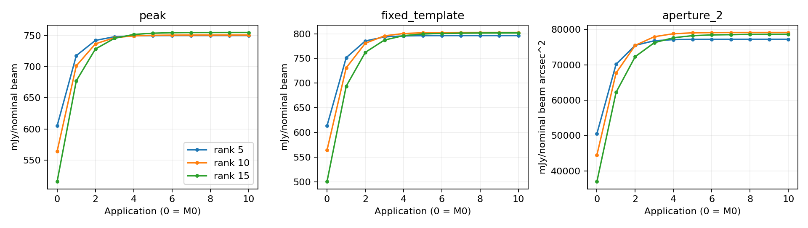
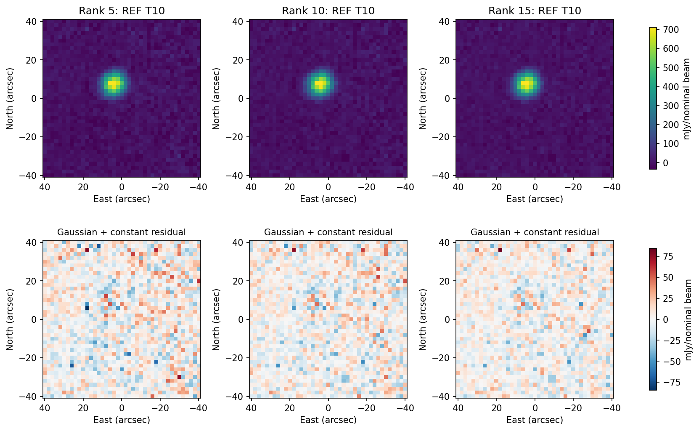
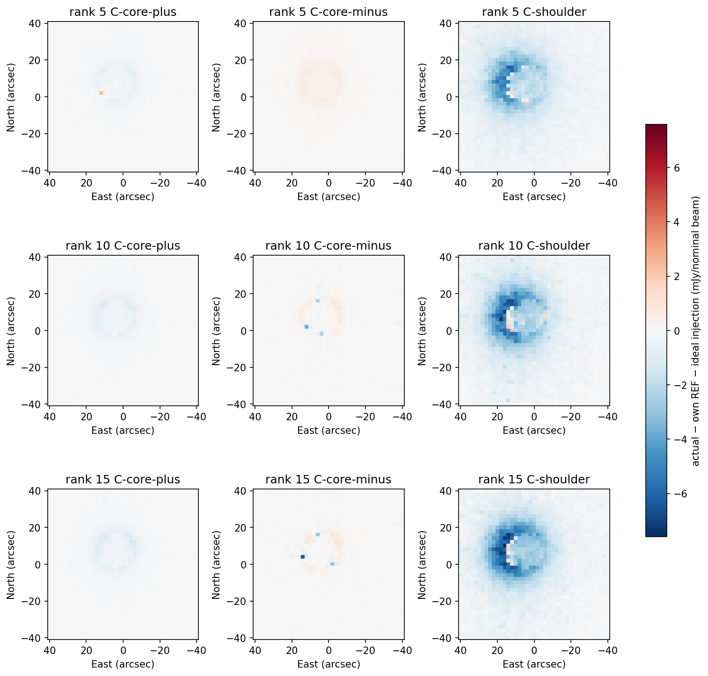
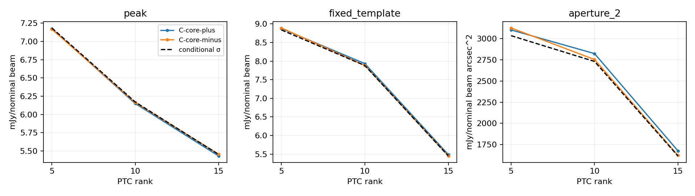

# PTC rank response and conditional noise: POINT 152430/a2000

**Keep rank 10 as the reference; rank 15 is a promising compact-source alternative
for independent confirmation.** Rank 15 improves the conditional uncertainty of
compact measurements after accounting for their measured response, without losing
coverage. It also increases the coherent loss of the broader shoulder. This is a
useful response/noise tradeoff, not an observationally general optimum or a new
default. Rank 5 retains somewhat more broad response but has higher conditional
measurement uncertainty.

All 12 cells completed M0–T10 on their first attempt: one original-input RTC/CAL
parent generation, 12 trajectory starts, 120 feedback applications, three REF noise
initializations, three REF endpoint analyses and nine ideal-addition controls.
Rank10 REF reproduced the frozen result exactly (maximum plane difference zero,
exact measurements/candidates/initial noise/endpoint quantities). All three rank10
injection regressions also passed. No numerical tolerance was relaxed.

[Full matrix](compact/report/matrix.json), [all-cycle measurements](compact/report/histories.json),
[generated tables](compact/report/REPORT.md), [source/build/configuration preflight](compact/PREFLIGHT.json),
and [native/coverage audit](compact/SAVED-AUDIT.json) retain the detailed evidence.

## Unmodified REF results lead the comparison

Peak/template are mJy/nominal beam; aperture is mJy/nominal beam arcsec², not
integrated flux. Each uncertainty is that rank's own conditional endpoint result.
The measurement template and apertures are the same physical geometry for all ranks.

| Rank | M0 peak | T10 peak ± conditional σ | T10 template ± σ | T10 aperture 2 ± σ | T10 background pixel std |
|---|---:|---:|---:|---:|---:|
| 5 | 605.000 | 749.802 ± 7.186 | 796.326 ± 8.839 | 77,220.8 ± 3,036.0 | 17.272 |
| 10 | 564.303 | 750.604 ± 6.171 | 802.621 ± 7.882 | 79,135.2 ± 2,731.2 | 15.800 |
| 15 | 515.716 | 754.723 ± 5.452 | 801.668 ± 5.448 | 78,638.7 ± 1,614.0 | 13.864 |

Rank15 T10 peak is 0.55% above rank10; its template is 0.12% lower and aperture is
0.63% lower. These are method sensitivities of shared observed data, not flux truth
or independently distributed measurements. Rank5 aperture is 2.42% below rank10.
Rank15 minus rank10 centroid is (+0.0070, −0.0226) arcsec; major/minor FWHM are
(10.023, 9.282) versus (10.138, 9.309) arcsec. Rank5 gives (10.044, 9.264) arcsec.
All source guards accepted. The common spatial figures retain coherent residual
structure: higher rank reduces background fluctuations but does not make the
source exactly Gaussian or eliminate all structured residuals.

T9–T10 peak changes are 0.00030, 0.00233 and 0.02260 mJy/nominal beam for ranks
5/10/15. Corresponding aperture changes are 0.070, 0.598 and 7.834 beam-brightness
arcsec². Even the largest is below 0.005 of its matching conditional σ. This is
small terminal drift over the authorized ten applications, not a proof of global
convergence. No extra application or favorable-iteration selection was used.

## Network populations, coverage and noise domains

Both networks show the residual-power trend. The following RMS is derived from
the existing observed-entry solver residual sum of squares divided by its eligible
population, after centering and fitting; it is not a new spectral estimator or a
MAP noise estimate. Units are mJy/nominal beam. Each network has six physical
processing segments; the original gaps, segment boundaries and sample masks remain.

| Rank | Network 11 M0 → last RMS | Network 12 M0 → last RMS |
|---|---:|---:|
| 5 | 118.178 → 116.271 | 322.422 → 321.383 |
| 10 | 106.195 → 104.294 | 287.011 → 285.858 |
| 15 | 99.149 → 97.344 | 262.996 → 261.873 |

Network11 retains 1,446,812 eligible entries from 417 contributing detector
identities; network12 retains 1,424,121 from 411. Counts are identical across ranks.
Requested and realized ranks match in every segment of every application; all fits
converged and no application failed. [Population diagnostics](compact/report/network-PTC.json)
include termination, iteration and residual histories. The route does not publish
before/after spectra or correlation summaries; no new spectral method or selected
detector gallery was added. Both networks support the residual-power conclusion;
source response and endpoint uncertainties here are for the combined array, so
independent per-network source-transfer confirmation is unavailable.

All 132 full native-support maps have exactly the same HITS, NORMALIZATION,
SCI_SUPPORT, NORM_SUPPORT and WCS as the corresponding rank10 REF. There are 10,513
science pixels, with no lost coverage hidden by an intersection mask. Native input
eligibility remains unchanged throughout. The admission/noise models were learned
separately from each rank's unperturbed M0. C0 source-exclusion masks contain
1,182 / 1,158 / 1,107 pixels; BASE masks contain 664 / 652 / 624. All retain 10,513
valid noise pixels and the same three above-training-coverage pixels. The changed
exclusions follow the fixed recipe's rank-dependent M0 fit, not transplanted noise
fields or data loss. [Exact domains](compact/report/noise-domains.json) are retained.

## Source response before and after feedback

The exact retained signed ±10% compact rasters and +5% displaced broad raster were
injected once at the post-RTC/CAL pre-PTC x boundary. r stayed diagnostic and
unchanged. Each current residual learned its own rank; no saved basis was truncated
or imported. T10 consumed m9, and m10 remains unapplied. All signals use the same
retained coordinates and taper, with no rank-specific refit or renormalization.

The source-disk spatial gain below is relative to own REF plus the injection-only
ordinary-MAP control. It describes the artificial increment, not percent flux of
the original source. The spatial distortion metric retains the residual morphology.

| Rank | Compact plus gain M0 → T10 | Compact minus gain M0 → T10 | Shoulder gain M0 → T10 | Shoulder T10 distortion η |
|---|---:|---:|---:|---:|
| 5 | 0.7364 → 0.9936 | 0.7391 → 0.9912 | 0.6169 → 0.8652 | 0.1863 |
| 10 | 0.5825 → 0.9907 | 0.6063 → 0.9991 | 0.4703 → 0.8446 | 0.2211 |
| 15 | 0.4926 → 0.9899 | 0.5041 → 0.9988 | 0.3908 → 0.8237 | 0.2459 |

Feedback recovers the compact response strongly at every rank. T10 compact peak
measurement gains lie between 0.9994 and 1.0039. Compact aperture gains are more
asymmetric: plus/minus are 0.9781/0.9708, 0.9671/0.9916, and 0.9638/0.9955. Their
largest mismatch is 0.37% of the full REF aperture and 0.18 of the matching
conditional σ. The sign asymmetry is retained, not averaged away.

The shoulder has a coherent spatial deficit rather than one uniform scalar loss.
Its T10 aperture gains are 0.8696, 0.8428 and 0.8162. Actual-minus-ideal aperture
biases are −2.16%, −2.55% and −3.00% of the full own REF source aperture, or
−0.55, −0.74 and −1.46 of the matching conditional σ. These are practical scales,
not paired significances. The stronger rank15 broader-response loss remains
consequential even though compact recovery is good.

Raw aperture and fitted-background effects differ. The shoulder's ideal raw
aperture increment is 14,462.1 for every rank; actual raw increments are 11,763.6,
11,287.3 and 10,830.4. Refitted-background subtraction reduces those discrepancies:
actual background increments are 626.2 / 465.5 / 364.5 versus ideal
1,655.1 / 1,622.5 / 1,640.1. The complete terms are in the saved histories; a single
source-disk gain cannot correct this distortion.

## Conditional uncertainty relative to compact response

For each measurement, sigma_equiv = own-REF endpoint σ / |own finite-response gain|.
Plus and minus remain separate. No such scalar correction is reported for the
shoulder. No map was rescaled. Supported compact gains are positive and near unity;
there is no sign reversal or severe compact distortion hidden by the absolute value.

| Rank | Peak σ_equiv (+ / −) | Template σ_equiv (+ / −) | Aperture 2 σ_equiv (+ / −) |
|---|---:|---:|---:|
| 5 | 7.175 / 7.168 | 8.878 / 8.893 | 3,103.9 / 3,127.5 |
| 10 | 6.150 / 6.164 | 7.933 / 7.884 | 2,824.0 / 2,754.3 |
| 15 | 5.431 / 5.456 | 5.488 / 5.452 | 1,674.5 / 1,621.3 |

Rank15's apparent compact uncertainty benefit survives response normalization:
about 12% for peak, 31% for template and 41% for aperture versus rank10. It is
therefore not explained simply by attenuating the compact increment or losing
coverage. The larger template/aperture reductions depend on each endpoint's
estimated spatial covariance and fitted-constant sensitivity. They are conditional
near this bright source, not blank-field sensitivity, mapping speed, absolute
calibration, or an empirically validated adaptive uncertainty law.

## Execution, retention and decision

Scientific source: e3cbf1eeadda256e4d9f400a834f9f7d462c1ae2, independently reviewed
before launch; later changes only complete reporting and evidence. The matching
binary, inputs, solver settings, original raster digests, common geometry and
predeclared comparator tolerances are bound in the compact execution/preflight.
The rank10 carrier was generated from originals once; no archived stream supplied
science. Local AppleClang/Homebrew and the recorded cached KIDs dependency
04088da-dirty provide local evidence, not Unity/Spack qualification.

Elapsed science time was 596.045 s with at most three concurrent branch workers,
two network workers for parent generation and single-thread numerical libraries.
Maximum sampled native-process RSS was 1.556 GB; the largest recorded stage-storage
snapshot was 2.744 GB against the enforced 8.824 GB ceiling. These are scoped
samples, not continuous system or filesystem high-water measurements. No unexpected
native error-level messages; the same endpoint NumPy matmul warning class as the
frozen route is retained in RUN.txt, with supported returned scales finite. No
scientific failure or replacement attempt was used.

Compact preservation, manifest and subsequent exact native-payload cleanup are
recorded beside this report. Protected inputs are rehashed before and after cleanup.
The existing 26.2 MB freeze and 235 MB comparison remain referenced in place. The
frozen tag/profile and unrelated work are unchanged; no push, merge, RTC change,
production promotion or new observation processing occurred.

**One next bounded action recommended, not executed:** independently confirm
rank15 against rank10 on one additional bright POINT observation using these same
compact and broad response controls and fixed downstream policy. Keep rank10 as the
reference until that confirmation; this result does not authorize RTC changes or
another comparison automatically.
