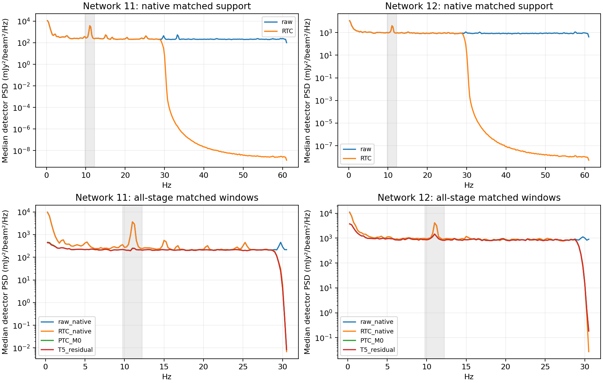
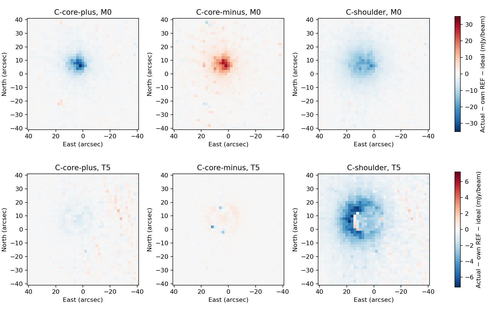

# RTC cost, contamination and source response

| Operation / target | Measured seconds | Before → RTC → PTC | Source / usable-support cost | Disposition |
|---|---:|---|---|---|
| RTC as a whole | A network 11 median 11.717; B 10.851; workers overlap | Detailed audit below | Compact RTC projection gain 0.996307; no injected support changes | Earns antialias/validity work; does not remove the 11 Hz line |
| Transient learning/review/support | 1.449 | 77/32 events;9/0 admitted shift groups;69888/93840 excluded pair cells | Source-near rejection remains diagnostically ambiguous | Completeness and false rejection not established here |
| Spectra, matched outcomes, reassessment | 4.910 |11 Hz power essentially unchanged by RTC; reduced by PTC, residual remains | No optional notch admitted in this acquisition | Consequential residual; next owner decision |
| Filter/application | 1.601 |35–60 Hz matched native band power falls by roughly10 orders of magnitude |307tap LPF; native finite support, factor2; boundary losses retained | Effective antialias filtering at measured scale |
| RTC arrays publication | A1.607 → B1.125 | Every binary payload and discrete choice exact | No scientific change | Retain B implementation efficiency; no measured end-to-end speedup |
| Donor replacement / ringing | No replacements exercised | No manufactured pathological observation |0 replaced or replacement-influenced cells | Not established here |

Seconds in operation rows are network 11 medians from three runs, except stated counts; network 12 is separately retained in timing.json. They are overlapping worker wall measurements, not additive end-to-end latency. CPU counters are process-wide.

## Latency and useful work

| Family | T5 published usable | Numerical analysis complete | Command exit | CPU seconds |
|---|---:|---:|---:|---:|
| A | 72.358 [71.607, 73.488] | 72.449 [71.699, 73.575] | 72.676 [71.924, 73.763] | 73.092 [72.080, 73.204] |
| B | 72.902 [72.074, 72.953] | 72.998 [72.156, 73.037] | 73.197 [72.366, 73.228] | 70.306 [69.999, 70.795] |

A RTC occupies **15.88–18.77%** of actual command wall time across the defensible per-run clock bounds, about one sixth rather than one half. Network clocks are relative; timing.json preserves each lower/upper occupancy bound instead of inventing an exact union. The shared wrapper and worker durations bound unknown starts. RTC process-CPU bounds span 19.15–21.12 core-seconds. The upper envelope can include CAL on the early-finishing worker; no exclusive thread CPU is claimed.

B reduces median RTC-array publication by 0.482s (30.0%) in network 11 and total command CPU by 3.81%. The median command exit is +0.520s relative to A, with overlapping ranges. **No end-to-end latency improvement is established.** CAL publication varies substantially and the remaining downstream/adapter work still dominates. B is retained as byte-preserving implementation efficiency, with source response inherited after three exact gates, not independently remeasured.

One workload at a time; two network workers, one feedback worker, one numerical-library thread. Fresh processes and original scientific state; OS cache not flushed and first-use observations retained. READY contains obtainable map/guard/measurement artifacts; caller 50 ms polling is separately stored. Required guard/noise/endpoint work and synchronous output remain included. Sampled process-tree RSS ranges are in timing.json; local Apple M4 Pro/two-network results do not extrapolate to Unity or all arrays. No operational deadline was invented.

## Population audit

| Network | Full detectors / matched spectra | Native cells / RTC x available | CAL/PTC eligible entries |11 Hz raw → RTC → M0 PTC → T5 residual median power |
|---|---:|---:|---:|---|
| 11 | 486 / 417 | 3801006 / 3241127 | 1446812 | 2551 → 2551 → 576 → 567.1 |
| 12 | 491 / 411 | 3839620 / 3312614 | 1424121 | 4319 → 4319 → 2538 → 2566 |

Power units are (mJy/nominal beam)², integrated9.75–12.25Hz. Spectra use the accepted sample CAL multiplier,4s Hann windows, median centering,50% overlap, contiguous genuine support, and identical physical duration/resolution. The source exclusion is the own-REF M0 four-major-FWHM circle evaluated at actual detector pointings. CAL/PTC cadence is half native; comparison uses shared bins up to its Nyquist. Frequencies absent from the output grid are not called removed. Full-population support counts precede matched-window comparisons;69/80 detectors lack a usable calibrated/matched spectrum and are not hidden from denominators.

Network 11: RTC11 Hz band detector median/p95 is 2551/1.001e+04; T5 residual is 567.1/2842. 80.7% of matched detector-windows have max line-bin/sideband-continuum >5 after RTC; 30.1% after T5. This is a descriptive prominence criterion, not a new filter/admission threshold. Residual pair coherence median at the nearest11 Hz bin is 0.796 in native RTC windows; matched output-window CAL/T5 medians are 0.791/0.082. Pair counts, common-window distributions, detector persistence and segment variation are retained.
44/77 reviewed events have seed pointings inside the conservative source-exclusion circle. This does not prove false rejection: r is not an optically pure witness and no independent event truth is available. Source-injection branches induce zero state/center changes. Full source-near versus background retention, event classes and raw-scale adjacent-difference outliers near/away from boundaries are retained; flag counts alone are not validation of complete event detection.

Network 12: RTC11 Hz band detector median/p95 is 4319/3.634e+04; T5 residual is 2566/3.063e+04. 56.1% of matched detector-windows have max line-bin/sideband-continuum >5 after RTC; 37.6% after T5. This is a descriptive prominence criterion, not a new filter/admission threshold. Residual pair coherence median at the nearest11 Hz bin is 0.414 in native RTC windows; matched output-window CAL/T5 medians are 0.459/0.111. Pair counts, common-window distributions, detector persistence and segment variation are retained.
10/32 reviewed events have seed pointings inside the conservative source-exclusion circle. This does not prove false rejection: r is not an optically pure witness and no independent event truth is available. Source-injection branches induce zero state/center changes. Full source-near versus background retention, event classes and raw-scale adjacent-difference outliers near/away from boundaries are retained; flag counts alone are not validation of complete event detection.

The observed high-frequency native residual suppression and deterministic finite-support/tone/gap fixtures support antialias behavior. No donor replacement occurred. Physical gaps are respected by fixtures and the diagnostic window check; these observations have one native run each, so real pathological-gap/replacement treatment remains unestablished. Slow common residuals are not classified as atmospheric or electronic here. T5 input subtracts the actual m4 operand; cleaned residual and restored total are reported separately. They coincide on the chosen source-excluded windows, so feedback restoration is not being mistaken for returned contamination.

## Source transfer and final measurement costs

All three exact retained sky rasters enter raw x once, at native ALIGN-assigned timestamps, divided only by selected flxscale×CAL atmosphere. Calibration-only reconstruction error is ≤1.43×10⁻¹⁴mJy/beam. r and immutable input validity are unchanged. Each branch executes its own RTC learning; plans/masks/decisions are retained. Own-REF M0 noise is shared within the family. This starts at RTC, not optical/IQ/ALIGN validation or an adaptive-noise ensemble.

| Branch | RTC spatial gain / relative error norm | T5 peak increment gain | T5 template gain | T5 aperture2 gain | T5 spatial gain / error norm |
|---|---|---:|---:|---:|---|
| C-core-plus | 0.996307 / 0.005973 | 0.991949 | 0.986107 | 0.962218 | 0.984701 / 0.036220 |
| C-core-minus | 0.996307 / 0.005973 | 0.991965 | 0.993690 | 0.988252 | 0.993262 / 0.025295 |
| C-shoulder | 0.999117 / 0.001957 | 1.045857 | 0.940874 | 0.839454 | 0.841944 / 0.222338 |

RTC delta is projected through own-REF MAP coefficients/support; its optional fitted diagnostic adds that delta to REF M0 and is explicitly conditional, not an independently reduced RTC sky map. Ideal sky is native-projected without RTC/PTC attenuation and independently agrees with the containing-pixel raster control. HITS, NORMALIZATION and science support remain exact for these branches; ideal support is never redefined by injection losses.

| T5 branch | Peak actual−ideal / own peak / σ | Pointing east,north discrepancy (arcsec) | Major,minor width discrepancy (arcsec) | Aperture2 discrepancy / σ |
|---|---|---|---|---|
| C-core-plus | -0.6043mJy/beam / -0.0805% / -0.098 | 0.000747, -0.000253 | -0.006129, -0.005031 | -303.24 / -0.110 |
| C-core-minus | 0.6031mJy/beam / 0.0804% / 0.098 | -0.002068, 0.001994 | -0.002341, -0.001522 | 94.29 / 0.034 |
| C-shoulder | 0.8769mJy/beam / 0.1169% / 0.142 | 0.000759, -0.007178 | 0.255571, -0.323599 | -2057.83 / -0.750 |

REF T5 conditional scales: peak6.164mJy/beam; east/north0.04049/0.03853arcsec; fitted width-axis scales0.04156/0.04686arcsec; fixed template7.898mJy/beam; aperture2 2744.34mJy/beam·arcsec². These are matching estimator scales, not paired significance or calibrated absolute sensitivity. Compact response-normalized scales are in effects.json only where supported; no maps are rescaled. The shoulder retains raw-aperture and fitted-constant contributions in source-responses.json and receives no scalar uncertainty correction. Large centroid/width *ratios* with nearly zero ideal increments are not meaningful gains; physical discrepancies above are the appropriate comparison. The approximately 5% final-science goal is not imposed as a per-RTC threshold.

The prior post-RTC/CAL warm-T5 response measurements remain in postRTC-controls.json as downstream controls. They are not relabeled as RTC transfer. No PTC selection, extra cycle, or source-model change was made.

## Outcome, limits and next action

RTC earns its antialias, boundary and validity work at this measured scale, with a small measured compact/broad transfer cost. It does **not** earn credit for removing the consequential11 Hz line: that feature survives RTC and still burdens PTC. Transient completeness/false rejection and donor replacement efficacy remain unestablished by this one observation. B demonstrates lower serialization/CPU work with identical science; whole-reduction latency remains about 73 s.

Keep warm-initialized fully re-solved observed-entry ALS rank 10, cold M0 and exactly five applications as this development endpoint. m4 is the last applied model; m5 is recorded only. Preserve the cold rank 10/T10 freeze and prior PCA/rank evidence. Retain B serialization as an implementation change only; source interpretation is inherited through exact equivalence. C is deliberately unselected, not failed.

**Prioritized next action:** obtain the owner decision on exact detector applicability/admission of the already selected 11.0062558446Hz,1Hz-width,approximately3s notch for POINT152430 networks 11/12; then propose one fixed-design comparison through the same T5 endpoint. The historical coefficient selection expressly did not automatically admit every detector/cadence. No new threshold, width sweep, automatic follow-on or further PTC/FRUIT optimization is started.

Executed 9 trajectories, 45 feedback applications and 1 extra RTC-only capture; no replacement trajectories. The initial FITS whole-file comparator stop is preserved: sealed historical T2/T4 bytes established checksum metadata differences and exact science, permitting continuation without rerun. Native error-level message count is zero. Numerical-library warnings are retained; all six A saved uncertainty operators/scales were independently reproduced exactly without the warned BLAS contraction, and B endpoint records match A exactly.

Campaign footprint before compact preservation 9.677GB against 20 GB ceiling. Native write volume, reservations, attempt logs and compact/cleanup manifests are distinct records. Saved-only reporting and final independent review precede deletion of exact enumerated campaign payloads; original/tune/APT/calibration/frozen profile dependencies are protected. Supplemental AppleClang/Homebrew evidence only; no Unity run, transfer, push, merge or production activation.

The figure branch names beginning C- identify retained control rasters; they are A-family response branches, not an executed policy family C. See [reproduction and evidence index](REPRODUCTION.md).
