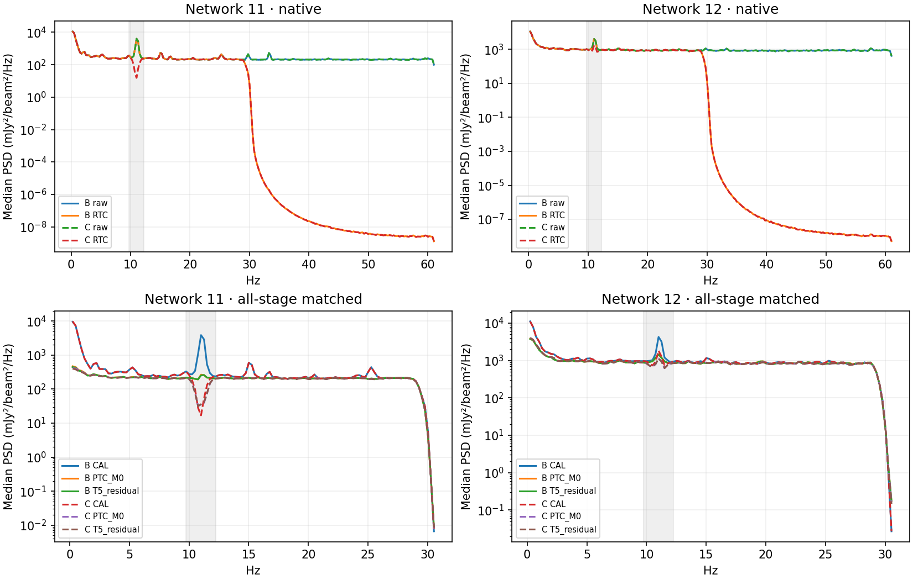
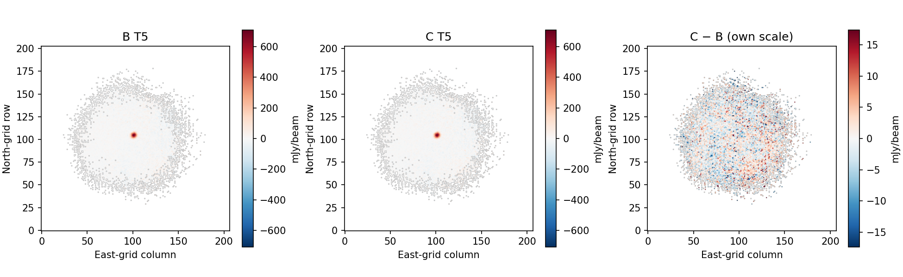
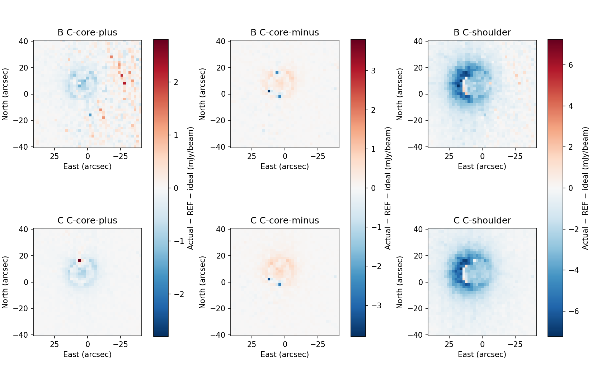

# Fixed 11 Hz notch: final five-feedback decision

| Quantity | B-control | C-fixed11 |
|---|---:|---:|
| Treatment, selected/full nw11; nw12 | No added notch | 331/486; 151/491 |
| nw11 treated RTC_native median 9.75–12.25 Hz power | 2845.9 | 378.66 |
| nw11 treated T5_residual median 9.75–12.25 Hz power | 545.248 | 263.475 |
| nw12 treated RTC_native median 9.75–12.25 Hz power | 2744.56 | 415.2 |
| nw12 treated T5_residual median 9.75–12.25 Hz power | 1015.99 | 698.125 |
| C-core-plus T5 peak / aperture2 increment gain | 0.991949 / 0.962218 | 0.992367 / 0.973981 |
| C-core-minus T5 peak / aperture2 increment gain | 0.991965 / 0.988252 | 0.991766 / 0.978931 |
| C-shoulder T5 peak / aperture2 increment gain | 1.045857 / 0.839454 | 1.030057 / 0.835059 |
| T5 peak conditional sigma (mJy/beam) | 6.16386 | 6.36845 |
| HITS total | 2.87093e+06 | 2.7794e+06 |
| SCI_SUPPORT total | 10513 | 10549 |
| Command exit median (s) | 73.914 | 83.074 |

**Recommendation: retain B-control and reject adoption of C-fixed11 for this measured
POINT endpoint.** The fixed notch clearly suppresses the selected contamination,
but it does not improve the final useful sensitivity enough to justify its
support and runtime cost. C remains a named experimental candidate; no production
default changes. This is an unfavorable measured tradeoff, not a failed execution
or a request for another design/search campaign.

## Why the spectrum improves but the endpoint does not

The treated population contains 331/486 nw11 detectors and 151/491 nw12 detectors.
The remaining 155 and 339 are uncertain; one nw12 detector is unselected without a
clearly identified feature. The 69/80 unavailable spectra remain in the uncertain
and full-population denominators. Independent preflight reproduced all 977
one-time decisions from prior unmodified, source-excluded x evidence before C.
The frozen set is not a calibrated classifier. Window prominence did not localize
individual window peak frequency; aggregate resolved peaks supplied that association.

On **identical B∩C physical all-stage windows**, treated median target-band power
falls by 86.7%/84.9% at RTC and by 51.7%/31.3% at the final cleaned residual
(nw11/nw12). PTC already removes much of B's feature. C still changes the final
residual spectrum, so the result is not exact final-product identity. Across the
whole measured network population, T5 median power changes from 570.85→327.01 and
2566.02→2179.30 (mJy/beam)². Network 12 retains substantial untreated/uncertain
contamination; no candidate result was used to expand membership. Upper tails,
absolute excess, prominence, prevalence, persistence and coherence for both
populations and every processing segment are in [METRICS.md](METRICS.md) and compact
machine-readable records. T5 input, cleaned residual and restored total are separate.
A notch-shaped hole is not a validated universal residual allowance.

T5 fitted peak changes 750.266→746.573 mJy/beam (−0.492%), east/north by
+0.01862/−0.01301 arcsec. The peak change is about 0.60 of B's conditional scale;
this is a shared-data method sensitivity, **not paired statistical significance**.
Peak conditional uncertainty rises 6.16386→6.36845 (+3.32%); template and aperture2
scales also rise. Common full-map background std is 17.9377→18.0545 mJy/beam,
robust scale 14.7747→14.9758; directional correlations are similar. The common
background difference std is 5.1811 mJy/beam. The source/map differences provide no
useful sensitivity improvement to offset the cost. The uncertainty models retain
own-arm masks and high-coverage continuation; they are conditional transfer models,
not absolute noise truth or a new uncertainty ensemble.

## Response and usable-data costs

C compact T5 peak gains are 0.992367 and 0.991766, versus inherited B's 0.991949
and 0.991965. The corresponding response-normalized conditional peak scales are
6.41744/6.42133 for C versus 6.21389/6.21379 for B. Compact response therefore does
not rescue the higher noise. Signs remain separate. Spatial distortion is modest
but not zero. C shoulder aperture gain 0.835059 is slightly below B's 0.839454;
the broader morphology still has substantial downstream attenuation. Raw aperture
and fitted-background terms are shown separately; no scalar shoulder correction
or map rescaling is applied. Physical peak, centroid, widths, template and aperture
discrepancies at RTC/M0/T5 are tabulated, with matching T5 scales where available.

Conditional RTC spatial gains are 0.995927 compact and 0.999008 shoulder, compared
with B's 0.996307 and 0.999117. These are projected injected-minus-own-REF differences
added to fixed own-REF M0 for fitted diagnostics, **not independent RTC maps**.
Exact original rasters enter original-derived native x once; r and validity remain
unchanged. Each branch follows active normal learning with the same fixed notch set.
This does not test an adaptive selector's response to injection.

All six C ideal controls retain all **2,779,396** own-reference contributions,
with zero mapping loss or lost ideal science pixels; RTC delta projection also loses
none. Mapping-unavailable native cells remain 453,618/3,801,006 (nw11) and
586,500/3,839,620 (nw12), and are not interpreted as zero astronomical response.
The inherited B ideal has **2,870,933** contributions. The distinct B→C difference
is **91,537 contributions, 3.1884%**, also lost from normalization. This loss is not
hidden by defining C's ideal on C support. No injection branch changes its own
HITS, normalization, or science-support arrays. B response is inherited through
the previous exact A↔B gate and the new exact B1 regression, not newly remeasured.

C loses 183,080 native available cells (2.79% of B available), all on treated
detectors; full/treated/untreated counts are retained before intersection. All
untreated filtered x/r and discrete support/speed/cause arrays are byte-identical.
Raw x/r are identical between unmodified arms. B→C science support loses 181 pixels
and gains 217, despite lower HITS everywhere they change; the support plane is a
realized map validity product, not a count of recovered exposure. The net +36
science pixels is not a coverage gain. Normalization and every contribution count
remain visible alongside it.

The exact 367-tap Hann notch has 1.4991474 s half-support; sequential application
with the unchanged 307-tap antialias filter gives 2.752533 s combined half-support.
At the historical full-precision center its combined amplitude is 0.0224023; its
1 Hz width is the design cutoff separation, not a half-power redefinition. Current
RTC owns application, paired coordinates, guards and phase-0 decimation; no padding
or shortened guards. Both networks have the same verified input cadence. The
realized response is plotted and coefficient hashes remain bound in DESIGN.json.

Existing event counts/classes and admitted jumps remain 77/32 and 9/0. Additional
unavailable cells occur in the finite-filter-support cause; speed masks remain
exact. Source-exclusion-region scheduled map centers fall 153,987→150,170 and
167,669→161,774. No donor replacement or unrepaired donor influence is exercised.
The retained event/end traces show wider missing support and the intended reduction
of rapid oscillation, with no conspicuous new large overshoot on the illustrated
retained intervals. Existing adjacent-difference >8 raw-MAD counts are zero in
both arms. These descriptive checks do not establish transient completeness,
absence of all ringing, or behavior across pathological gaps absent from this
single physical-run observation.

## Cost, correctness and disposition

Median raw-to-usable T5 is 73.643→82.746 s; analysis completion 73.731→82.829 s;
command exit 73.914→83.074 s (+12.39%). Exit ranges do not overlap in the three
retained repeats. Median whole-command CPU is 71.874→82.489 core-seconds (+14.77%).
RTC worker-clock occupancy bounds, operation intervals and sampled process-tree
RSS are retained separately; parallel worker durations are never added as latency.
No first-use run was discarded; caches were not flushed. No local two-network
result is extrapolated to Unity or the full instrument.

All nine trajectories, 45 outer applications and two additional RTC-only captures
completed on `b3d997456a8b9762d9fc323e37827f96b4ec7b37`. No replacement trajectory. The 11 original ingresses (including captures)
produced 22 completed network RTC Apply attempts and zero scientific revisions.
B1 exactly reproduces the completed B control, and all own-arm repeats are exact.
M0 is cold; warm observed-entry ALS fully re-solves rank10 through five feedback
applications, T5 consumes m4 and m5 is recorded only. Other science contracts and
defaults are unchanged. Native unexpected error-level messages are zero. Local
numerical-library warnings are retained; all nine uncertainty operators and scales
independently reproduce exactly using non-BLAS contraction. Focused preflight and
report/cleanup fixtures pass; details and exact build identity are in the record.

The completed campaign footprint was 10.489 GB before reporting additions against
a 20 GB bound; the conservative reserved estimate was 10.723 GB. This is distinct
from 12.371 GB cumulative native write volume. Compact preservation retains 236.8 MB in 1,863 files. Saved-only reproduction
passed with the original campaign tree and 31 inputs denied by the OS. Final
independent review precedes exact enumerated native cleanup.
Original inputs and all prior compact evidence are protected. See
[REPRODUCTION.md](REPRODUCTION.md) and the final review/cleanup receipts for closure.

**Stop here.** B remains the current development reference; C-fixed11 is the
measured, unpromoted experimental comparison. No new observation, threshold/design
search, PTC/FRUIT optimization, push, merge, production activation, or automatic
follow-on is started.

## Closure

Independent final review passed with no actionable findings at `f3428f67f`.
Guarded cleanup removed all126,500 planned native files (8.597 GB), preserving
all31 original dependencies and1,608 prior compact objects. The six figures and
three report text/JSON artifacts reproduced exactly after cleanup with originals
and the campaign tree denied. Compact evidence is236.8 MB. Remaining metadata,
FITS and logs are counted in CLOSEOUT.json; the campaign directory was not deleted.
