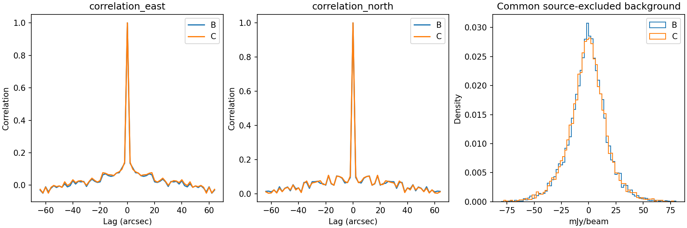
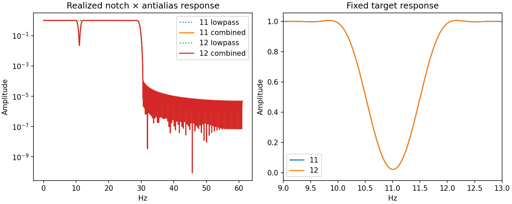
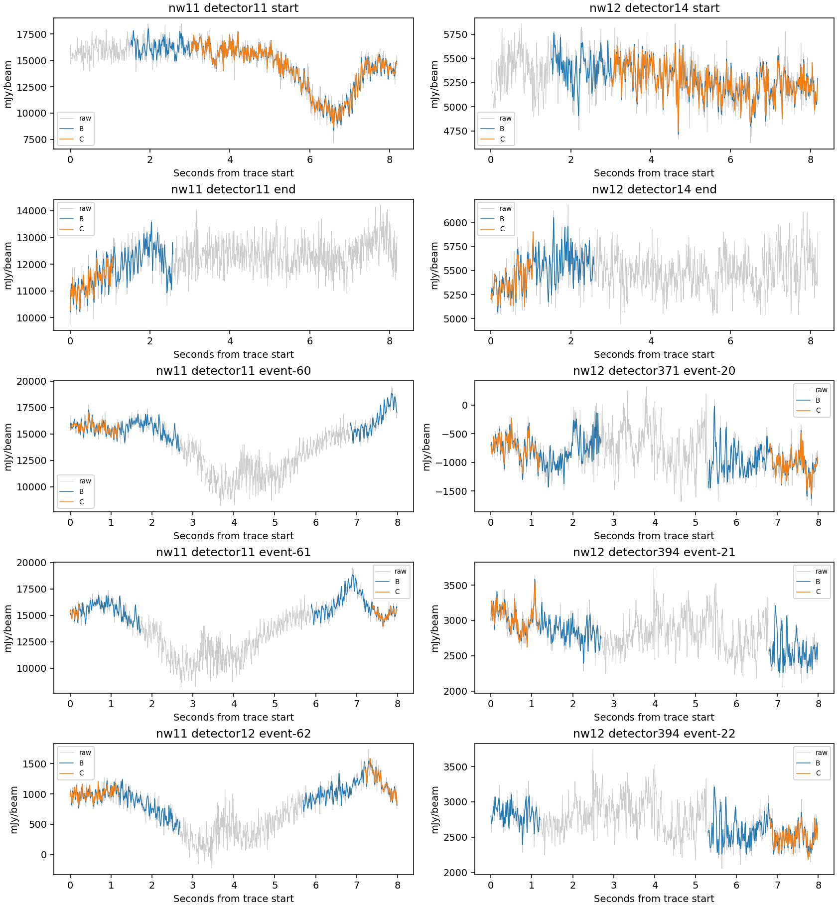

# Fixed 11 Hz saved-data comparison

B response is inherited from the prior A→B exact equivalence, reconfirmed by the new B1 gate. C is independently remeasured. Shared-data method sensitivities; conditional background-transfer uncertainties are not paired significance or absolute calibration truth.

| Quantity | B-control | C-fixed11 |
|---|---:|---:|
| Treatment, selected/full nw11; nw12 | No added notch | 331/486; 151/491 |
| nw11 treated RTC_native median 9.75–12.25 Hz power | 2845.9 | 378.66 |
| nw11 treated T5_residual median 9.75–12.25 Hz power | 545.248 | 263.475 |
| nw12 treated RTC_native median 9.75–12.25 Hz power | 2744.56 | 415.2 |
| nw12 treated T5_residual median 9.75–12.25 Hz power | 1015.99 | 698.125 |
| C-core-plus T5 peak / aperture2 increment gain | 0.991949 / 0.962218 | 0.992367 / 0.973981 |
| C-core-minus T5 peak / aperture2 increment gain | 0.991965 / 0.988252 | 0.991766 / 0.978931 |
| C-shoulder T5 peak / aperture2 increment gain | 1.045857 / 0.839454 | 1.030057 / 0.835059 |
| T5 peak conditional sigma (mJy/beam) | 6.16386 | 6.36845 |
| HITS total | 2.87093e+06 | 2.7794e+06 |
| SCI_SUPPORT total | 10513 | 10549 |
| Command exit median (s) | 73.914 | 83.074 |

Integrated power units: (mJy/nominal beam)². Native x is converted with its accepted sample CAL multiplier for comparison; native RTC remains raw Δf/f. All-stage spectra use identical B∩C physical windows and fixed B M0 source exclusion. Full support losses below precede intersection.

## Timing: all repeats retained

| Arm | Repeat | Usable T5 | Analysis | Exit | CPU | RTC wall bounds | Sampled tree RSS GB |
|---|---:|---:|---:|---:|---:|---|---:|
| B | 1 | 73.643 | 73.731 | 73.914 | 70.344 | 10.836–11.144 | 1.706 |
| B | 2 | 71.744 | 71.811 | 71.989 | 71.937 | 11.044–11.978 | 1.706 |
| B | 3 | 73.917 | 74.001 | 74.216 | 71.874 | 11.080–11.112 | 1.705 |
| C | 1 | 81.593 | 81.693 | 81.896 | 81.813 | 12.962–14.139 | 2.111 |
| C | 2 | 82.746 | 82.829 | 83.074 | 82.489 | 13.158–15.294 | 2.102 |
| C | 3 | 83.728 | 83.822 | 84.038 | 83.103 | 12.977–13.014 | 1.596 |

| Arm | Metric | Median | Minimum | Maximum |
|---|---|---:|---:|---:|
| B | ready | 73.6426 | 71.7444 | 73.9168 |
| B | analysis | 73.7309 | 71.8113 | 74.001 |
| B | exit | 73.9139 | 71.9894 | 74.2156 |
| B | CPU | 71.8735 | 70.3437 | 71.9367 |
| B | sampled_tree_RSS | 1.70564e+09 | 1.70462e+09 | 1.70593e+09 |
| C | ready | 82.746 | 81.5933 | 83.7278 |
| C | analysis | 82.8294 | 81.6932 | 83.8218 |
| C | exit | 83.074 | 81.8955 | 84.0381 |
| C | CPU | 82.4887 | 81.813 | 83.1033 |
| C | sampled_tree_RSS | 2.10226e+09 | 1.59613e+09 | 2.11075e+09 |

RTC bounds use overlapping worker clocks, never worker sums as latency. Process CPU bounds and operation intervals are in timing.json. Required synchronous output/noise work is included. RTC captures and response extraction are untimed diagnostics; no overhead subtraction. Fresh processes, first use retained, OS caches not flushed. One workload, two network workers, one feedback worker and numerical thread.

## Matched contamination

| Arm / network / population | Stage | Spectral/full detectors | Median / p95 power | Median excess | Median / p95 prominence | Prominent windows % | Median persistence |
|---|---|---:|---|---:|---|---:|---:|
| B/11/full | raw_native | 417/486 | 2690.25 / 10679.9 | 2127.33 | 22.7248 / 70.8316 | 81.3298 | 0.916667 |
| B/11/full | RTC_native | 417/486 | 2690.27 / 10679.9 | 2127.34 | 22.7245 / 70.831 | 81.3298 | 0.916667 |
| B/11/full | CAL | 417/486 | 2687.1 / 10666.2 | 2125.81 | 22.6616 / 70.892 | 81.2345 | 0.916667 |
| B/11/full | PTC_M0 | 417/486 | 576.58 / 2958.01 | 209.626 | 4.29864 / 7.31942 | 30.844 | 0.285714 |
| B/11/full | T5_input | 417/486 | 2687.1 / 10666.2 | 2125.81 | 22.6616 / 70.892 | 81.2345 | 0.916667 |
| B/11/full | T5_residual | 417/486 | 570.848 / 2834.47 | 210.804 | 4.26812 / 7.04313 | 30.4629 | 0.285714 |
| B/11/full | T5_total | 417/486 | 570.848 / 2834.47 | 210.804 | 4.26812 / 7.04313 | 30.4629 | 0.285714 |
| B/11/treated | raw_native | 331/331 | 2845.88 / 11368 | 2411 | 30.2879 / 76.7632 | 92.2741 | 1 |
| B/11/treated | RTC_native | 331/331 | 2845.9 / 11368.1 | 2411.01 | 30.2878 / 76.7633 | 92.2741 | 1 |
| B/11/treated | CAL | 331/331 | 2840.9 / 11355.8 | 2408.69 | 30.2984 / 76.5782 | 92.1715 | 1 |
| B/11/treated | PTC_M0 | 331/331 | 550.511 / 2387.79 | 193.111 | 4.30959 / 7.65024 | 31.1858 | 0.285714 |
| B/11/treated | T5_input | 331/331 | 2840.9 / 11355.8 | 2408.69 | 30.2984 / 76.5782 | 92.1715 | 1 |
| B/11/treated | T5_residual | 331/331 | 545.248 / 2333.44 | 191.258 | 4.28365 / 7.17128 | 30.6725 | 0.285714 |
| B/11/treated | T5_total | 331/331 | 545.248 / 2333.44 | 191.258 | 4.28365 / 7.17128 | 30.6725 | 0.285714 |
| B/11/untreated | raw_native | 86/155 | 907.881 / 8790.73 | 433.057 | 6.65083 / 9.99247 | 49.8152 | 0.529412 |
| B/11/untreated | RTC_native | 86/155 | 907.89 / 8790.83 | 433.06 | 6.65078 / 9.99246 | 49.8152 | 0.529412 |
| B/11/untreated | CAL | 86/155 | 907.388 / 8781.53 | 432.984 | 6.64923 / 9.9755 | 49.7413 | 0.529412 |
| B/11/untreated | PTC_M0 | 86/155 | 693.413 / 4400.28 | 242.362 | 4.25525 / 5.67876 | 29.8596 | 0.294118 |
| B/11/untreated | T5_input | 86/155 | 907.388 / 8781.53 | 432.984 | 6.64923 / 9.9755 | 49.7413 | 0.529412 |
| B/11/untreated | T5_residual | 86/155 | 678.897 / 4525.87 | 249.928 | 4.18933 / 5.88268 | 29.8596 | 0.289916 |
| B/11/untreated | T5_total | 86/155 | 678.897 / 4525.87 | 249.928 | 4.18933 / 5.88268 | 29.8596 | 0.289916 |
| B/12/full | raw_native | 411/491 | 4367.21 / 36530.8 | 2398.93 | 7.25441 / 45.7487 | 55.7718 | 0.5625 |
| B/12/full | RTC_native | 411/491 | 4367.24 / 36531.4 | 2398.94 | 7.25434 / 45.748 | 55.7718 | 0.5625 |
| B/12/full | CAL | 411/491 | 4362.92 / 36508.3 | 2397.31 | 7.24673 / 45.5965 | 55.7911 | 0.5625 |
| B/12/full | PTC_M0 | 411/491 | 2537.7 / 30609.5 | 1063.62 | 4.83515 / 11.0491 | 37.5024 | 0.352941 |
| B/12/full | T5_input | 411/491 | 4362.92 / 36508.3 | 2397.31 | 7.24673 / 45.5965 | 55.7911 | 0.5625 |
| B/12/full | T5_residual | 411/491 | 2566.02 / 30628.3 | 1071.71 | 4.86313 / 11.0782 | 37.5988 | 0.357143 |
| B/12/full | T5_total | 411/491 | 2566.02 / 30628.3 | 1071.71 | 4.86313 / 11.0782 | 37.5988 | 0.357143 |
| B/12/treated | raw_native | 151/151 | 2744.55 / 13170.3 | 2070.56 | 18.6865 / 75.92 | 86.0038 | 0.894737 |
| B/12/treated | RTC_native | 151/151 | 2744.56 / 13170.4 | 2070.56 | 18.6865 / 75.9194 | 86.0038 | 0.894737 |
| B/12/treated | CAL | 151/151 | 2742.03 / 13162.1 | 2067.17 | 18.6863 / 75.7467 | 86.0038 | 0.894737 |
| B/12/treated | PTC_M0 | 151/151 | 1011.18 / 6175.27 | 498.385 | 5.91992 / 14.242 | 50.2217 | 0.5 |
| B/12/treated | T5_input | 151/151 | 2742.03 / 13162.1 | 2067.17 | 18.6863 / 75.7467 | 86.0038 | 0.894737 |
| B/12/treated | T5_residual | 151/151 | 1015.99 / 6340.21 | 503.569 | 5.98512 / 14.0032 | 50.285 | 0.473684 |
| B/12/treated | T5_total | 151/151 | 1015.99 / 6340.21 | 503.569 | 5.98512 / 14.0032 | 50.285 | 0.473684 |
| B/12/untreated | raw_native | 260/340 | 6489.43 / 43461.1 | 2671.35 | 5.34895 / 9.17041 | 42.5485 | 0.416667 |
| B/12/untreated | RTC_native | 260/340 | 6489.5 / 43461.6 | 2671.36 | 5.34895 / 9.17038 | 42.5485 | 0.416667 |
| B/12/untreated | CAL | 260/340 | 6485.1 / 43492.1 | 2663.61 | 5.34125 / 9.1695 | 42.5762 | 0.416667 |
| B/12/untreated | PTC_M0 | 260/340 | 5132.56 / 32577.4 | 1745.15 | 4.44364 / 6.7804 | 31.9391 | 0.307692 |
| B/12/untreated | T5_input | 260/340 | 6485.1 / 43492.1 | 2663.61 | 5.34125 / 9.1695 | 42.5762 | 0.416667 |
| B/12/untreated | T5_residual | 260/340 | 5117.8 / 32571.8 | 1779.54 | 4.44369 / 6.91727 | 32.0499 | 0.307692 |
| B/12/untreated | T5_total | 260/340 | 5117.8 / 32571.8 | 1779.54 | 4.44369 / 6.91727 | 32.0499 | 0.307692 |
| C/11/full | raw_native | 417/486 | 2690.25 / 10679.9 | 2127.33 | 22.7248 / 70.8316 | 81.3298 | 0.916667 |
| C/11/full | RTC_native | 417/486 | 446.177 / 3326.53 | 70.6088 | 3.54804 / 8.34035 | 26.9956 | 0.210526 |
| C/11/full | CAL | 417/486 | 446.111 / 3325.89 | 71.8431 | 3.54191 / 8.313 | 26.9194 | 0.210526 |
| C/11/full | PTC_M0 | 417/486 | 328.612 / 2241.71 | 46.7263 | 2.99951 / 5.91795 | 18.8607 | 0.142857 |
| C/11/full | T5_input | 417/486 | 446.111 / 3325.89 | 71.8431 | 3.54191 / 8.313 | 26.9194 | 0.210526 |
| C/11/full | T5_residual | 417/486 | 327.006 / 2252.95 | 45.6058 | 3.01472 / 5.8675 | 18.6893 | 0.142857 |
| C/11/full | T5_total | 417/486 | 327.006 / 2252.95 | 45.6058 | 3.01472 / 5.8675 | 18.6893 | 0.142857 |
| C/11/treated | raw_native | 331/331 | 2845.88 / 11368 | 2411 | 30.2879 / 76.7632 | 92.2741 | 1 |
| C/11/treated | RTC_native | 331/331 | 378.66 / 1377.21 | 53.9193 | 3.24968 / 4.98973 | 19.0708 | 0.181818 |
| C/11/treated | CAL | 331/331 | 378.675 / 1376.68 | 54.8558 | 3.25251 / 4.98673 | 18.9938 | 0.181818 |
| C/11/treated | PTC_M0 | 331/331 | 265.389 / 1110.85 | 31.8671 | 2.78814 / 4.28298 | 13.655 | 0.111111 |
| C/11/treated | T5_input | 331/331 | 378.675 / 1376.68 | 54.8558 | 3.25251 / 4.98673 | 18.9938 | 0.181818 |
| C/11/treated | T5_residual | 331/331 | 263.475 / 1125.26 | 32.3563 | 2.7997 / 4.33416 | 13.578 | 0.111111 |
| C/11/treated | T5_total | 331/331 | 263.475 / 1125.26 | 32.3563 | 2.7997 / 4.33416 | 13.578 | 0.111111 |
| C/11/untreated | raw_native | 86/155 | 907.881 / 8790.73 | 433.057 | 6.65083 / 9.99247 | 49.8152 | 0.529412 |
| C/11/untreated | RTC_native | 86/155 | 907.89 / 8790.83 | 433.06 | 6.65078 / 9.99246 | 49.8152 | 0.529412 |
| C/11/untreated | CAL | 86/155 | 907.388 / 8781.53 | 432.984 | 6.64923 / 9.9755 | 49.7413 | 0.529412 |
| C/11/untreated | PTC_M0 | 86/155 | 720.051 / 4388.42 | 275.201 | 4.68935 / 7.18989 | 33.8507 | 0.352941 |
| C/11/untreated | T5_input | 86/155 | 907.388 / 8781.53 | 432.984 | 6.64923 / 9.9755 | 49.7413 | 0.529412 |
| C/11/untreated | T5_residual | 86/155 | 716.99 / 4019.17 | 269.287 | 4.63989 / 6.83621 | 33.4072 | 0.333333 |
| C/11/untreated | T5_total | 86/155 | 716.99 / 4019.17 | 269.287 | 4.63989 / 6.83621 | 33.4072 | 0.333333 |
| C/12/full | raw_native | 411/491 | 4367.21 / 36530.8 | 2398.93 | 7.25441 / 45.7487 | 55.7718 | 0.5625 |
| C/12/full | RTC_native | 411/491 | 2458.2 / 34573.4 | 1020.88 | 4.38071 / 8.99568 | 33.9757 | 0.315789 |
| C/12/full | CAL | 411/491 | 2454.9 / 34559.7 | 1022.51 | 4.3795 / 8.99865 | 33.995 | 0.333333 |
| C/12/full | PTC_M0 | 411/491 | 2182.61 / 24686.8 | 723.474 | 4.49536 / 8.71082 | 31.6053 | 0.307692 |
| C/12/full | T5_input | 411/491 | 2454.9 / 34559.7 | 1022.51 | 4.3795 / 8.99865 | 33.995 | 0.333333 |
| C/12/full | T5_residual | 411/491 | 2179.3 / 24692.1 | 717.413 | 4.50465 / 8.79569 | 31.6631 | 0.307692 |
| C/12/full | T5_total | 411/491 | 2179.3 / 24692.1 | 717.413 | 4.50465 / 8.79569 | 31.6631 | 0.307692 |
| C/12/treated | raw_native | 151/151 | 2744.55 / 13170.3 | 2070.56 | 18.6865 / 75.92 | 86.0038 | 0.894737 |
| C/12/treated | RTC_native | 151/151 | 415.2 / 2427.11 | 49.9001 | 2.88953 / 4.5766 | 14.3762 | 0.125 |
| C/12/treated | CAL | 151/151 | 415.315 / 2422.21 | 49.7588 | 2.88892 / 4.58522 | 14.3762 | 0.125 |
| C/12/treated | PTC_M0 | 151/151 | 686.938 / 3096.86 | 180.706 | 4.17775 / 13.4797 | 29.5123 | 0.25 |
| C/12/treated | T5_input | 151/151 | 415.315 / 2422.21 | 49.7588 | 2.88892 / 4.58522 | 14.3762 | 0.125 |
| C/12/treated | T5_residual | 151/151 | 698.125 / 3111.14 | 179.804 | 4.13601 / 13.5901 | 29.7657 | 0.266667 |
| C/12/treated | T5_total | 151/151 | 698.125 / 3111.14 | 179.804 | 4.13601 / 13.5901 | 29.7657 | 0.266667 |
| C/12/untreated | raw_native | 260/340 | 6489.43 / 43461.1 | 2671.35 | 5.34895 / 9.17041 | 42.5485 | 0.416667 |
| C/12/untreated | RTC_native | 260/340 | 6489.5 / 43461.6 | 2671.36 | 5.34895 / 9.17038 | 42.5485 | 0.416667 |
| C/12/untreated | CAL | 260/340 | 6485.1 / 43492.1 | 2663.61 | 5.34125 / 9.1695 | 42.5762 | 0.416667 |
| C/12/untreated | PTC_M0 | 260/340 | 5132 / 32810.7 | 1869.05 | 4.55346 / 6.34754 | 32.5208 | 0.333333 |
| C/12/untreated | T5_input | 260/340 | 6485.1 / 43492.1 | 2663.61 | 5.34125 / 9.1695 | 42.5762 | 0.416667 |
| C/12/untreated | T5_residual | 260/340 | 5125.39 / 32781.3 | 1867.93 | 4.5662 / 6.25538 | 32.4931 | 0.333333 |
| C/12/untreated | T5_total | 260/340 | 5125.39 / 32781.3 | 1867.93 | 4.5662 / 6.25538 | 32.4931 | 0.333333 |

Window and detector distributions, maxima, prevalence, persistence, per-processing-segment rows and absent-estimate denominators are retained in matched-population-summary.json. The two networks each have one physical native run; processing scan segments do not create new RTC domains. Prominence >5 is the inherited descriptive statistic, not a residual allowance or production threshold.

## Coherence

| Arm / network | Population / stage | Pairs | Median | p95 |
|---|---|---:|---:|---:|
| B/11 | full/raw | 85689 | 0.81083 | 0.953909 |
| B/11 | full/RTC | 85689 | 0.810829 | 0.953909 |
| B/11 | full/CAL | 85279 | 0.806362 | 0.954875 |
| B/11 | full/PTC_M0 | 85279 | 0.0971485 | 0.413706 |
| B/11 | full/T5_residual | 85279 | 0.0978382 | 0.41597 |
| B/11 | full/T5_total | 85279 | 0.0978382 | 0.41597 |
| B/12 | full/raw | 82983 | 0.41681 | 0.897054 |
| B/12 | full/RTC | 82983 | 0.416808 | 0.897053 |
| B/12 | full/CAL | 81299 | 0.463191 | 0.916765 |
| B/12 | full/PTC_M0 | 81299 | 0.113986 | 0.531367 |
| B/12 | full/T5_residual | 81299 | 0.114054 | 0.53141 |
| B/12 | full/T5_total | 81299 | 0.114054 | 0.53141 |
| B/11 | treated/raw | 53847 | 0.878243 | 0.960561 |
| B/11 | treated/RTC | 53847 | 0.878242 | 0.960561 |
| B/11 | treated/CAL | 53573 | 0.875136 | 0.961769 |
| B/11 | treated/PTC_M0 | 53573 | 0.0995648 | 0.425037 |
| B/11 | treated/T5_residual | 53573 | 0.0997705 | 0.424348 |
| B/11 | treated/T5_total | 53573 | 0.0997705 | 0.424348 |
| B/12 | treated/raw | 10955 | 0.855754 | 0.964847 |
| B/12 | treated/RTC | 10955 | 0.855753 | 0.964846 |
| B/12 | treated/CAL | 10578 | 0.87672 | 0.974272 |
| B/12 | treated/PTC_M0 | 10578 | 0.191464 | 0.720246 |
| B/12 | treated/T5_residual | 10578 | 0.192617 | 0.720409 |
| B/12 | treated/T5_total | 10578 | 0.192617 | 0.720409 |
| C/11 | full/raw | 85689 | 0.81083 | 0.953909 |
| C/11 | full/RTC | 85689 | 0.57226 | 0.86013 |
| C/11 | full/CAL | 85279 | 0.596834 | 0.880124 |
| C/11 | full/PTC_M0 | 85279 | 0.200868 | 0.727455 |
| C/11 | full/T5_residual | 85279 | 0.202426 | 0.747528 |
| C/11 | full/T5_total | 85279 | 0.202426 | 0.747528 |
| C/12 | full/raw | 82983 | 0.41681 | 0.897054 |
| C/12 | full/RTC | 82983 | 0.320319 | 0.742985 |
| C/12 | full/CAL | 81299 | 0.355164 | 0.777758 |
| C/12 | full/PTC_M0 | 81299 | 0.20966 | 0.929562 |
| C/12 | full/T5_residual | 81299 | 0.209985 | 0.932029 |
| C/12 | full/T5_total | 81299 | 0.209985 | 0.932029 |
| C/11 | treated/raw | 53847 | 0.878243 | 0.960561 |
| C/11 | treated/RTC | 53847 | 0.662018 | 0.879039 |
| C/11 | treated/CAL | 53573 | 0.685296 | 0.896799 |
| C/11 | treated/PTC_M0 | 53573 | 0.232538 | 0.772243 |
| C/11 | treated/T5_residual | 53573 | 0.239271 | 0.794868 |
| C/11 | treated/T5_total | 53573 | 0.239271 | 0.794868 |
| C/12 | treated/raw | 10955 | 0.855754 | 0.964847 |
| C/12 | treated/RTC | 10955 | 0.588805 | 0.883046 |
| C/12 | treated/CAL | 10578 | 0.582836 | 0.896492 |
| C/12 | treated/PTC_M0 | 10578 | 0.897972 | 0.983786 |
| C/12 | treated/T5_residual | 10578 | 0.899737 | 0.983851 |
| C/12 | treated/T5_total | 10578 | 0.899737 | 0.983851 |

Same nearest-11-Hz bin, all eligible pairs with at least three common complete windows; no electronics attribution.

## Full-domain support before matching

| Network / population | Native cells | B / C available | Lost / gained | B / C scheduled map centers | Lost scheduled centers |
|---|---:|---|---|---|---:|
| 11/full | 3801006 | 3241127 / 3116241 | 124886 / 0 | 1597680 / 1535590 | 62090 |
| 11/treated | 2588751 | 2296697 / 2171811 | 124886 / 0 | 1132130 / 1070040 | 62090 |
| 11/untreated | 1212255 | 944430 / 944430 | 0 / 0 | 465550 / 465550 | 0 |
| 12/full | 3839620 | 3312614 / 3254420 | 58194 / 0 | 1632941 / 1604007 | 28934 |
| 12/treated | 1180820 | 1046044 / 987850 | 58194 / 0 | 515650 / 486716 | 28934 |
| 12/untreated | 2658800 | 2266570 / 2266570 | 0 / 0 | 1117291 / 1117291 | 0 |

| Arm / network | Events / candidates / admitted jumps | Replacement / donor-influenced cells | Unrepaired influence | Source-near original / map-center scheduled cells |
|---|---|---|---:|---|
| B/11 | 77 / 721 / 9 | 0 / 0 | 0 | 195065 / 153987 |
| B/12 | 32 / 33 / 0 | 0 / 0 | 0 | 180353 / 167669 |
| C/11 | 77 / 721 / 9 | 0 / 0 | 0 | 195065 / 150170 |
| C/12 | 32 / 33 / 0 | 0 / 0 | 0 | 180353 / 161774 |

Raw x/r and all untreated filtered x/r, state, center, speed and cause arrays are byte-identical. Treated x/r share the fixed filter without coordinate mixing. Cause distributions and raw-scale adjacent-difference diagnostics within 0.25 s of unavailable boundaries versus away are retained for every detector. No donor replacement is exercised; one physical run per network limits real gap/replacement conclusions.

## Final T5 physical source differences

| Measurement | B | C | C−B | B / C conditional sigma |
|---|---:|---:|---:|---|
| peak | 750.266 | 746.573 | -3.69265 | 6.16386 / 6.36845 |
| east | 4.0566 | 4.07523 | 0.0186227 | 0.040489 / 0.0411611 |
| north | 7.37901 | 7.366 | -0.0130105 | 0.0385337 / 0.0400005 |
| FWHM_major | 10.1357 | 10.1307 | -0.00499102 | unavailable / unavailable |
| FWHM_minor | 9.3052 | 9.29035 | -0.0148477 | unavailable / unavailable |
| ellipse_xx | 17.4517 | 17.356 | -0.0956903 | unavailable / unavailable |
| ellipse_xy | -1.40513 | -1.43659 | -0.0314533 | unavailable / unavailable |
| ellipse_yy | 16.6896 | 16.7173 | 0.0276579 | unavailable / unavailable |
| background | -2.38314 | -2.47397 | -0.0908316 | 2.13941 / 2.21273 |
| fixed_template | 802.044 | 797.396 | -4.64811 | 7.89804 / 8.03067 |
| aperture_1 | 74928.1 | 74455.9 | -472.154 | 1033.68 / 1049 |
| aperture_1p5 | 77713.4 | 77309.8 | -403.602 | 1892.65 / 1918.38 |
| aperture_2 | 79035.9 | 78778.3 | -257.606 | 2744.34 / 2788.99 |

Width-axis uncertainty keys sx/sy describe fitted sigma axes; they are not already FWHM-major/minor errors. No unsupported direct width discrepancy/scale ratio is claimed.

## Source response: each sign and morphology

| Arm / branch / stage | Spatial gain / distortion | Peak / template / aperture2 increment gain |
|---|---|---|
| B/C-core-plus/T0 | 0.579010 / 0.456259 | 0.663103 / 0.598889 / 0.420404 |
| B/C-core-plus/conditional RTC | 0.996307 / 0.005973 | Fixed own-REF M0 projection; not an independent RTC map |
| B/C-core-plus/T5 | 0.984701 / 0.036220 | 0.991949 / 0.986107 / 0.962218 |
| B/C-core-minus/T0 | 0.602775 / 0.445827 | 0.690517 / 0.626277 / 0.432951 |
| B/C-core-minus/conditional RTC | 0.996307 / 0.005973 | Fixed own-REF M0 projection; not an independent RTC map |
| B/C-core-minus/T5 | 0.993262 / 0.025295 | 0.991965 / 0.993690 / 0.988252 |
| B/C-shoulder/T0 | 0.469421 / 0.557305 | 0.466277 / 0.499381 / 0.478629 |
| B/C-shoulder/conditional RTC | 0.999117 / 0.001957 | Fixed own-REF M0 projection; not an independent RTC map |
| B/C-shoulder/T5 | 0.841944 / 0.222338 | 1.045857 / 0.940874 / 0.839454 |
| C/C-core-plus/T0 | 0.601769 / 0.426835 | 0.685440 / 0.624089 / 0.461770 |
| C/C-core-plus/conditional RTC | 0.995927 / 0.006746 | Fixed own-REF M0 projection; not an independent RTC map |
| C/C-core-plus/T5 | 0.987776 / 0.023120 | 0.992367 / 0.989495 / 0.973981 |
| C/C-core-minus/T0 | 0.619522 / 0.408732 | 0.701553 / 0.641763 / 0.483043 |
| C/C-core-minus/conditional RTC | 0.995927 / 0.006746 | Fixed own-REF M0 projection; not an independent RTC map |
| C/C-core-minus/T5 | 0.989468 / 0.025069 | 0.991766 / 0.990727 / 0.978931 |
| C/C-shoulder/T0 | 0.478614 / 0.544567 | 0.547520 / 0.534839 / 0.495967 |
| C/C-shoulder/conditional RTC | 0.999008 / 0.002183 | Fixed own-REF M0 projection; not an independent RTC map |
| C/C-shoulder/T5 | 0.838448 / 0.222832 | 1.030057 / 0.942165 / 0.835059 |

All physical actual−ideal discrepancies (peak, centroid, widths, template, each aperture, background), conditional scales, and allowed compact response-normalized scales are in effects.json. Raw-aperture and fitted-background terms remain in each source-responses.json. No scalar shoulder correction or science-map rescaling.

## Background and support

| Arm | Common background pixels | Mean | Std | Robust scale | Full hits | Full science pixels |
|---|---:|---:|---:|---:|---:|---:|
| B | 9044 | -0.840615 | 17.9377 | 14.7747 | 2870933 | 10513 |
| C | 9044 | -1.04177 | 18.0545 | 14.9758 | 2779396 | 10549 |

Background uses existing four-FWHM union exclusion on common supported full-map pixels, ordinary mean removal and existing 32-pixel / 200-pair covariance. Conditional endpoint models keep their original own-arm masks. No new uncertainty ensemble.

## Physical response discrepancies

Actual minus ideal addition; peak/template in mJy/beam, centroid/width in arcsec, aperture2 in mJy/beam arcsec². RTC rows are conditional fixed-M0 projections.

| Arm / branch / stage | Peak | East / north | Major / minor FWHM | Template | Aperture2 |
|---|---:|---|---|---:|---:|
| B/C-core-plus/T0 | -25.3764 | 0.0344401 / 0.00187882 | -0.0624916 / -0.128814 | -32.183 | -4637.99 |
| B/C-core-plus/conditional RTC | -0.562658 | -0.000213782 / 0.000228568 | 0.0035671 / 0.00341221 | -0.322965 | 0.782808 |
| B/C-core-plus/T5 | -0.604289 | 0.000746979 / -0.000253254 | -0.00612892 / -0.00503107 | -1.11526 | -303.239 |
| B/C-core-minus/T0 | 23.3303 | -0.0343379 / 0.000387771 | 0.100066 / 0.139516 | 29.9815 | 4534.12 |
| B/C-core-minus/conditional RTC | 0.561523 | 0.00024703 / -0.000312379 | -0.00436771 / -0.00412044 | 0.323761 | -0.32408 |
| B/C-core-minus/T5 | 0.603094 | -0.00206841 / 0.00199375 | -0.00234082 / -0.00152162 | 0.506556 | 94.2885 |
| B/C-shoulder/T0 | -11.5984 | -0.0358676 / 0.00695937 | -0.215719 / -0.226221 | -25.5512 | -6571.61 |
| B/C-shoulder/conditional RTC | -0.0545239 | -0.000577041 / 8.47258e-05 | -0.000405577 / -0.00036478 | -0.0790975 | -7.14248 |
| B/C-shoulder/T5 | 0.876921 | 0.00075872 / -0.00717814 | 0.255571 / -0.323599 | -3.03964 | -2057.83 |
| C/C-core-plus/T0 | -23.6821 | 0.0280705 / -0.00170407 | -0.0704928 / -0.1167 | -30.16 | -4306.12 |
| C/C-core-plus/conditional RTC | -0.636553 | -0.00014005 / 0.000289387 | 0.00419067 / 0.0040027 | -0.356427 | 0.808924 |
| C/C-core-plus/T5 | -0.572983 | 0.000435283 / 0.000757857 | -0.00419257 / -0.00136489 | -0.843332 | -208.822 |
| C/C-core-minus/T0 | 22.4843 | -0.0347823 / 0.000321243 | 0.0893081 / 0.142208 | 28.7378 | 4132.44 |
| C/C-core-minus/conditional RTC | 0.636238 | 0.000135744 / -0.00039376 | -0.00515642 / -0.00484931 | 0.357372 | -0.264499 |
| C/C-core-minus/T5 | 0.618125 | -0.00131506 / 0.00320659 | -0.00059052 / 0.00296866 | 0.744396 | 169.089 |
| C/C-shoulder/T0 | -9.72923 | -0.0462672 / 0.00546669 | -0.229762 / -0.225793 | -23.7403 | -6352.35 |
| C/C-shoulder/conditional RTC | -0.0588747 | -0.000631842 / 0.000110227 | -0.000472001 / -0.000457419 | -0.0876051 | -8.19215 |
| C/C-shoulder/T5 | 0.593322 | -0.0030603 / -0.00196544 | -0.0410948 / -0.0536163 | -2.97525 | -2117.48 |

## Shoulder aperture accounting at T5

| Arm / construction | Raw aperture2 | Fitted-background term | Net aperture2 |
|---|---:|---:|---:|
| B/reference | 76290.5 | -2745.38 | 79035.9 |
| B/actual | 87562 | -2233.83 | 89795.8 |
| B/ideal_map_addition | 90752.7 | -1100.99 | 91853.6 |
| C/reference | 75928.3 | -2850.02 | 78778.3 |
| C/actual | 87101.6 | -2397.08 | 89498.6 |
| C/ideal_map_addition | 90390.4 | -1225.71 | 91616.1 |

## Combined response and boundary illustrations

Traces use the first selected detector at each physical end and the first three B events in selected detectors per network. Invalid filter support remains missing. They illustrate existing events rather than validating their completeness. Full population near-boundary/away adjacent-difference records are in population-support.json.
