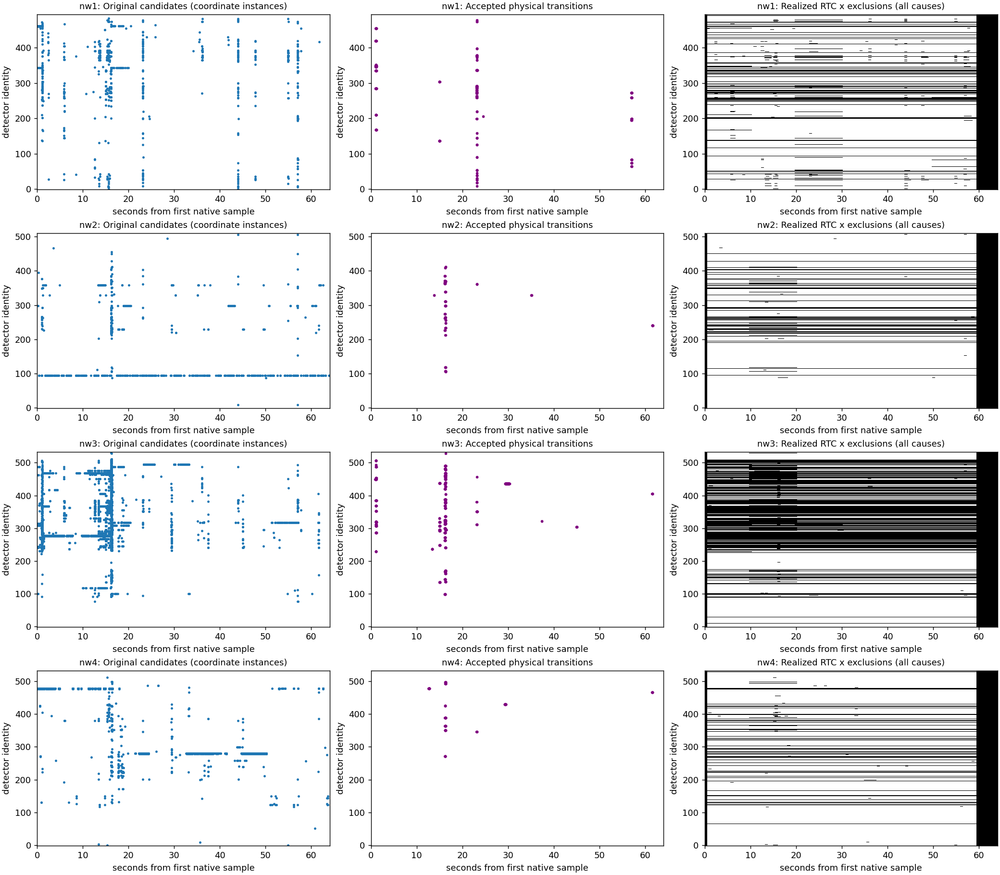
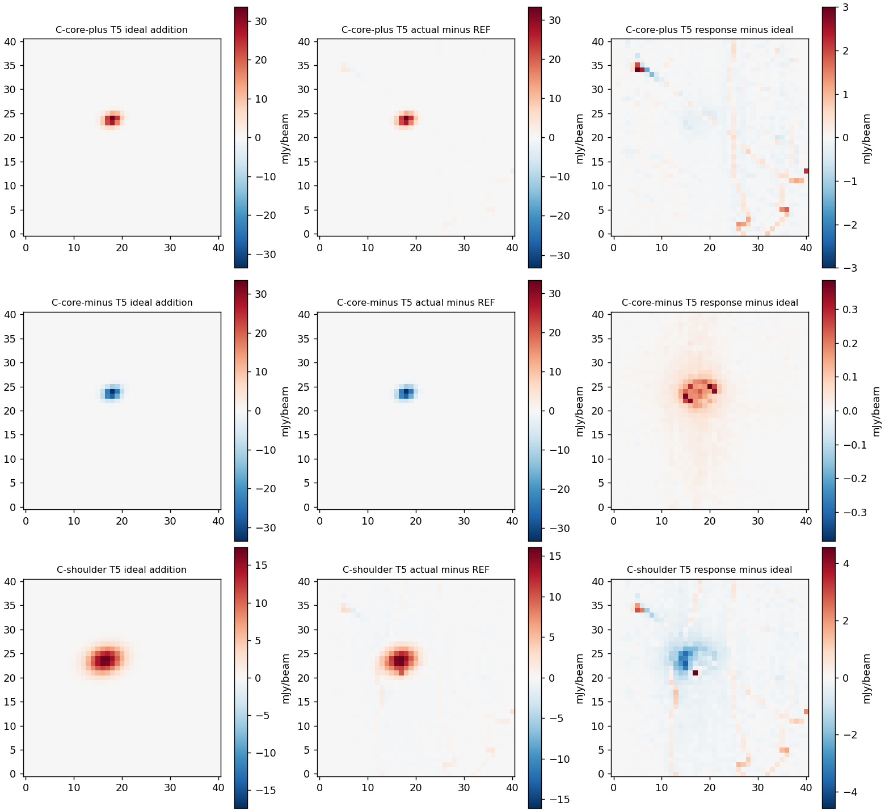

# POINT152430/0/2: consequences of RTC step decisions, networks 1–4

**The strongest measured concern is exposure lost to unresolved event extent, especially on network 3.** Its RTC retention is 49.73% of initially valid x detector-time. Run-wide unresolved exclusions account for 13,571.52 detector-seconds after earlier rules, about 80.1% of that network's loss. This is **potentially costly treatment requiring a comparison**, not demonstrated over-rejection. Stable-looking original stretches exist inside broad exclusions; their recoverable scientific information remains unmeasured.

**Observed:** several transitions with no local Learn candidates survive RTC/CAL and are largely removed by PTC. The bounded examples do not establish a consequential PTC penalty or justify simply adding more flags. Compact T5 spatial response is 0.9895–0.9909; peak response is within 0.04% of ideal, and template response is within 1%. **Support is not wholly stable:** positive compact and broad injections each admit one additional event and lose 1,188 RTC cells. Broad T5 spatial gain is 0.8486, with aperture response down to 0.8165. These morphology limits remain explicit; they do not reopen FRUIT here.

**Decision:** retain B and park fixed11. No numerical treatment changes or production promotion. The one proposed next comparison below concerns containment of unresolved exclusions, not catalogue completeness. It is unimplemented and requires a separate owner decision.

## Four-network population and method

These are APT-verified **a1100 partial-array** outputs, not the earlier a2000/nw11,12 result. All four complete original-derived networks, telescope/auxiliary data, exact tunes, APT and calibration were ready locally; inventory and hashes are in [INPUT_INVENTORY.json](INPUT_INVENTORY.json), [PREFLIGHT.md](PREFLIGHT.md) and compact input receipts. No Unity retrieval or execution occurred. Previous campaigns are context only, never treatment controls.

| Network | Detectors | Raw candidate coordinate instances | Event groups / admitted | Admitted detectors | Admitted groups / 1000 valid detector-s | Valid x detector-s | RTC retained detector-s | RTC loss |
|---|---:|---:|---:|---:|---:|---:|---:|---:|
| 1 | 494 | 879 | 504 / 51 | 48 | 1.659 | 30,749.49 | 24,185.43 | 21.35% |
| 2 | 510 | 889 | 344 / 25 | 24 | 0.782 | 31,970.75 | 26,340.93 | 17.61% |
| 3 | 533 | 5,180 | 1,083 / 72 | 66 | 2.136 | 33,700.63 | 16,757.77 | 50.27% |
| 4 | 532 | 2,230 | 597 / 11 | 11 | 0.333 | 32,995.86 | 26,801.52 | 18.77% |

There are 2,528 detector-event groups and 159 admissions, including 130 x-only, 21 r-only and 8 joint groups. Networks 1–3 have up to two admitted events per detector; network 4 up to one. Descriptive 50-ms seed clustering gives 5/6/9/6 clusters, not an independently established count of shared physical disturbances. Original peer context supports shared disturbances, while detector-local evidence remains eligible. Non-admitted classes, respectively by network: isolated-admission-unavailable 263/231/219/176; no-resolved-excursion 81/19/184/69; unresolved-extent 109/69/608/341. Their affected detector counts and coordinate causes are retained in `compact/report/decision-reasons.json`. Entire populations are not independently adjudicated truth; targeted windows cannot yield precision/recall.

All four networks contain one continuous physical run, about 64 s, with six numerical processing scans. Boundaries of those scans are not physical gaps. The approved a1100 profile uses 67 lowpass taps, factor 1, native integration 0.008192 s, measured cadence about 0.008192062 s and nominal 5-arcsec beam. Raw RTC units are Δf/f; CAL follows RTC. Downstream uses rank-10 warm-initialized **fully re-solved** observed-entry ALS, cold M0, exactly five FRUIT applications, 2-arcsec grid, 40-arcsec feedback, threshold-3 source-connected BASE, unity gain and full replacement. T5 consumes m4; m5 remains unapplied. Fits and warm state remain branch/network/physical-segment local. The exact source/config/raster bindings are retained; no old array noise package or raster was imported.

## Decisions and downstream consequences

The [complete 32-window consequence table](generated/CONSEQUENCES.md) records original interpretation, raw candidate trace, actual Consider cause, RTC exposure/source crossings, CAL/M0/T5 residuals, attribution limits and disposition. The machine-readable table retains overlapping masks and physical-unit statistics. Original and stage figures are in [the frozen window record](generated/N14-REF-rep2/). Original images were viewed and adjudicated before stage images; the historical receipt is preserved. Selection remained fixed at four event plus four control windows per network.

**Selection-label correction:** the inherited selector called controls “candidate-free,” but actually excluded nearby **event-group seeds**. n3_w4 contains 15 raw candidates in unresolved group 642; n4_w4 contains 13 in unresolved group 535. The other control excerpts have no raw candidate or overlapping trial. This correction changes interpretation, not selection. A missing nearby group seed is not a Learn omission. [WINDOW_RULES.md](WINDOW_RULES.md) documents the erratum.

Observed classes:

- **Admitted finite transitions:** large and ordinary x-only/joint examples have supported original level changes. r-only examples n2_w2/n3_w2/n4_w2 also show large original x changes: r-only admission is not evidence that x is unaffected. Accepted transitions create boundaries and paired scan exclusions; offsets are not subtracted or plateaus stitched. Most selected admitted-event excerpts have no RTC/CAL/PTC support. Their downstream residual is unavailable, not zero. No measurement here establishes whether all paired or scan loss is necessary.
- **Untreated retained transitions:** n1_w4, n2_w4, n2_w6 and n3_w6 have no raw candidate in the excerpt. CAL median contrasts are −8,346, +6,365, −4,248 and +4,189 mJy/beam. T5 residual contrasts are +50, +28, +54 and −141 mJy/beam, against local adjacent-difference MAD scales 133, 224, 955 and 159. M0 already removes most structure. This is **adequate at the measured local scale**, attributed to PTC; RTC benefit or a consequential PTC penalty is not established. Medians are descriptive, not significance; some edges lie away from the declared center.
- **Finite excursion n1_w5:** the CAL trough is strongly suppressed by PTC. The lower fifth percentile relative to the window median changes from −1,160 to −182 mJy/beam; T5 center-based contrast is21 and local difference MAD105 mJy/beam. A positive local outlier remains. This illustrates why center statistics cannot certify an off-center excursion or every residual. Source/map harm, ringing beyond noise and benefit from another RTC operation are **not established**. Quiet controls provide local noise context, not a transfer-function bound.
- **Unresolved or globally withheld examples:** n2_w5, n3_w4/w5 and n4_w4/w5/w7 are wholly absent downstream, including some supported original transitions and smooth stretches. Existing unresolved groups can remove an entire detector physical run even when this excerpt contains no local candidate. This is a support-policy consequence, not automatically failed Learn coverage. Gross loss is measured; plausibly reusable stretches are observationally suggested; demonstrated recoverable information is unavailable.

No automatic hard-spike admission or donor synthesis occurred. An isolated recovered candidate lacks an approved natural isolated-event treatment, so operation support can remain unavailable. A seeded event without resolved recovery and without admitted jump receives whole-physical-run unavailability; a resolved jump instead uses the existing transition/scan policy. Primary amplitude, short-flank consistency, finite transition and the existing one support-overlap reassessment govern admission. Exact coordinate causes/supports remain in the event chain; overlap guards are fit masks, not automatically output exclusions.

## Exposure and correctness

The sequential ledger starts with valid x, then outside-science, transition, jump-scan, transient, unresolved extent, remaining operation-unavailable, outside-resolved, donor contamination and complete-filter-support expansion. Each incremental loss uses the immediately preceding eligible set. Intersections and the union are retained; order is bookkeeping, not unique causal attribution.

| Network | Outside science | Physical transition | Additional jump scan | Unresolved extent | Other operation | Complete filter expansion |
|---|---:|---:|---:|---:|---:|---:|
| 1 | 2,217.74 | 3.76 | 501.75 | 3,408.13 | 66.72 | 365.96 |
| 2 | 2,309.61 | 1.27 | 238.59 | 2,803.20 | 7.86 | 269.28 |
| 3 | 2,434.58 | 7.96 | 707.95 | 13,571.52 | 13.72 | 207.12 |
| 4 | 2,383.67 | 1.33 | 98.62 | 3,407.61 | 17.33 | 285.79 |

Units are detector-seconds. Other listed masks add zero after these overlaps, not zero gross influence. Short admitted runs number 11/1/9/10; filter erosion includes these losses. The total retained RTC domain differs from CAL eligibility and actual MAP input; mapping/calibration/selection cannot be charged indiscriminately to steps.

Own-M0 geometric source context contains 751,590 valid cells. RTC retains 551,616: 26.61% loss. Unresolved extent accounts incrementally for 144,273 source-context cells (19.20% of valid context). This context is geometric and is not the production optical-protection decision; the inherited explicit empty protected-region authority remains unchanged.

| Network | Actual M0 and T5 MAP contributions | Source context contributions | Background contributions |
|---|---:|---:|---:|
| 1 | 2,526,957 | 130,262 | 2,396,695 |
| 2 | 2,846,710 | 175,802 | 2,670,908 |
| 3 | 1,733,290 | 91,950 | 1,641,340 |
| 4 | 2,699,042 | 153,602 | 2,545,440 |

The actual total is 9,805,999 at both endpoints, with the same summed normalization under existing uniform gamma. Sample counts are not independent information or measured sensitivity. `compact/report/MAP-exposure.json` separately retains science-supported map contributions.

**Correctness observed:** independent complete-67-tap erosion checks on all 16 successful network applications find zero plan/realized x-support differences, zero admitted-run physical-gap crossings and zero donor replacement/influence. Independent x/r validity is retained and paired handling is unchanged. Existing fixture tests cover gaps not present here. No treatment correctness defect was found. A CLI routing defect was separately repaired before the replacement run; it did not change scientific owners.

## Active source response and uncertainty

All deterministic rasters came from this subset's accepted own-M0 source. Compact ±10% analytic amplitude is ±35.9798 mJy/beam; displaced broad +5% is 17.9899 mJy/beam, twice each measured width, displaced half a measured FWHM east, with the inherited 30–36 arcsec taper and no renormalization. Exact parameters/hashes are in `compact/N14-REF-rep2/SHAPES.json`. Injection occurs once in original-derived x before RTC; r and original validity remain identical. Mapping-unavailable cells are counted separately. **All 9,805,999 REF MAP contributions have available ideal injection mapping.**

| Branch | Conditional RTC spatial g / η | M0 g / η | T5 g / η | T5 peak | Template | Aperture 1 / 1.5 / 2 FWHM |
|---|---|---|---|---:|---:|---|
| Compact + | 0.99839 / 0.00222 | 0.75311 / 0.29734 | 0.99090 / 0.08299 | 0.99963 | 0.99190 | 0.98488 / 0.97160 / 0.96174 |
| Compact − | 0.99852 / 0.00214 | 0.75223 / 0.28647 | 0.98951 / 0.02149 | 1.00037 | 0.99016 | 0.98089 / 0.96589 / 0.95906 |
| Broad + | 0.99959 / 0.00061 | 0.63232 / 0.41349 | 0.84860 / 0.24002 | 1.06742 | 0.93130 | 0.93319 / 0.85625 / 0.81653 |

Estimator ratios compare signed increments with ideal addition on full unchanged REF support. Spatial g and η are conditional on common available pixels within the 40-arcsec disk; they cannot hide the explicit support losses below. RTC projected differences added to a fixed map are conditional transfer diagnostics, not independently reduced sky maps. No T5 sigma is attached to RTC-only fits.

**Active changes:** compact+ and broad each add nw1/channel446/event445 at row137. Original fitted x offset is 3.5543e−6, local scale 7.4286e−8, with strong original peer evidence. Injection is exactly zero over the event's original fit support and across its seed difference, but nonzero elsewhere on that detector. Candidate scores are 5.0173 and 5.0056; this is consistent with changed block-noise normalization admitting an existing near-threshold disturbance, not an injected local step. A REF score for this absent candidate was not retained; that mechanism is an **inference**, not a new fitted counterfactual. The admitted finite transition survives the existing reassessment; r is not seeded. Both branches lose 1,188 RTC cells on nw1; 1,170 are map-center cells. Broad also shortens nw2/channel202 operation unavailability from [1983,2091) to [1983,1997), gaining 94 cells. Its injected signal is zero at the seed but reaches 1.1851e−8 within the fit support; the fitted background/extent changes. Compact− shortens a nw3/channel381 boundary by one row with no realized support change. No ambiguous, missing or physically shifted matched events were found. Full chains and scalar explanations are retained in `compact/report/response/`.

Compact+ MAP contributions fall to 9,804,811 (185 HITS/normalization pixels change); broad has 9,804,905 (197 pixels change). Each loses one science-supported pixel and gains none; compact− is exactly support-stable. The projected RTC difference is unavailable for 1,188 REF contributions in 160 science pixels for the positive branches; this is reported as unavailable, never zero. Ideal normalization retains the full REF domain. Thus near-unity conditional RTC gain is not a universal full-domain transfer claim. Compact+ distortion exceeds compact− and includes off-source residual structure; no per-event causal decomposition was performed.

T5 peak discrepancies actual-minus-ideal are −0.0141, −0.0128 and +0.7072 mJy/beam; matching ordinary REF conditional peak sigma is 15.3291. Template discrepancies are −0.2911, +0.3541 and −1.6870 mJy/beam against sigma17.5111. Two-FWHM aperture discrepancies are −37.02, +39.83 and −324.89 mJy/beam arcsec² against sigma2,132.06. These are at most 0.046, 0.096 and 0.152 of those single-map scales, respectively, **not paired-difference significance**. They do not prove universally negligible deterministic bias. Raw aperture sums and background subtraction terms are retained, not folded into one unexplained ratio.

Centroid discrepancies in east/north arcsec: compact+ (−0.00106,+0.00042), compact− (+0.000063,+0.000048), broad (−0.00809,−0.00429), against ordinary coordinate scales0.1152/0.0693 arcsec. Major/minor FWHM discrepancies: (−0.00412,−0.00229), (+0.00696,+0.00333), (−0.05521,−0.01257) arcsec. REF T5's fitted angle reaches its lower bound; all relevant amplitude Jacobians have rank7, while injected/ideal fits are interior. Width/angle linearized uncertainty and ellipse orientation therefore need boundary caution; sigma-width parameters are not FWHM sigmas. Near-zero ideal position/shape increments make their ratios misleading, so absolute discrepancies govern. Own-M0 guard sigma_A is14.9834, distinct from T5 uncertainty.

**Inferred:** strong M0 attenuation and partial T5 restoration place the broad morphology limitation downstream of the near-unity conditional RTC transfer. **Untested:** exact attribution to individual step decisions versus PTC/feedback nonlinearities or a different treatment's benefit. No broad-reconstruction optimization is authorized.

## Cost, execution and validation

Science used exact source `839f31b28b52de6a46bc9c2dc623673378839cfa`, tree `591de3682d5626fe494a61388c66800b5c95f99d`, after an independently reviewed CLI scope repair. See [ROUTING_DEFECT.md](ROUTING_DEFECT.md). The first launch loaded four original networks but reached no spike screening, RTC Apply, M0 or feedback. It remains preserved and conservatively charged: **5 parents/trajectories, 4 completed endpoints, 20 feedback applications, 16 initial network Apply starts/completions, zero extra RTC-only captures; the one replacement is used.** No automatic retry or additional science is permitted.

Stored coordinate-level internal requests total492 refits,202 remeasurements,158 reassessed coordinates and670 coordinate admissions across the four successful branches. These overlap and are not independent RTC launches. They are retained separately in `compact/report/internal-reassessments.json`.

| Run | Command wall s | CPU s | Sampled process-tree RSS GB | RTC occupied-wall bounds s |
|---|---:|---:|---:|---|
| REF replacement | 146.417 | 156.896 | 2.630 | 18.082–39.554 |
| Compact + | 150.242 | 159.932 | 2.817 | 18.704–42.054 |
| Compact − | 147.639 | 159.125 | 3.126 | 17.960–40.057 |
| Broad + | 151.704 | 158.465 | 2.535 | 18.036–43.019 |

Fixed policy: one observational workload, two network workers, one numerical thread per worker and one feedback worker. Sampled RSS is not a guaranteed true maximum. Overlapping network intervals prevent treating their sums as command wall. REF summed network costs include16.066s event assessment,5.582s initial spectra,0.580s screening,0.515s support decisions,0.865s plans,1.025s Apply,1.787s initial evidence publication,4.688s array export and6.683s post-filter outcome export; diagnostic relearning and serialization remain included. CAL publication separately costs23.667 summed network seconds. The failed routing launch costs6.195 command seconds. No repeats, scaling or speedup conclusion.

Numerical preflight reserved a conservative27.676GB against a30GB campaign ceiling and2GB free reserve. Completed footprint before final compact reporting was12.277GB; native write volume15.597GB is not retained disk occupancy. Local AppleClang/Homebrew cached dependencies are supplemental evidence, not Unity/Spack reproduction; inherited kids dirty identity is recorded in machine/build receipts.

Gates at science source:22 native step/scope fixtures;1,314 enabled CTests;204 POINT Python tests;38 focused tests;207 baseline tests; full config preflight. The pre-existing intentionally disabled legacy46-observation lifecycle replay is outside this scope. Earlier missing-fixture failures are preserved alongside completed gates. Successful runs have zero unexpected native error-level messages. Three NumPy runtime warnings per successful run triggered independent saved-operator checks: all endpoint scales are finite and exactly agree under non-BLAS contraction; no new uncertainty ensemble was made. Failed routing messages remain explicit.

## One proposed comparison — not implemented or authorized

The strongest issue is **scope of containment for unresolved extent**, not Learn coverage. Proposed single experimental change: for non-admitted `unresolved-extent` groups only, replace whole-physical-run unavailability with the union of complete existing processing science scans that intersect the hull of the stored trial interval and both stored affected ranges; retain the existing outside-science exclusion and full filter-support erosion. Union all events normally. All other admissions, thresholds, guards, paired validity, donors, source protection, calibration, rank, feedback, maps and uncertainty stay identical. No hand-picked detector whitelist or change to what counts as an event.

This is an explicitly experimental containment hypothesis, **not proof that a processing boundary ends a physical disturbance**. It would require owner approval to depart from the current unresolved-extent contract. Expected benefit is restoring potentially useful stretches of detectors now withheld for the entire run, especially nw3. Risks are extended disturbance leaking beyond the stored affected search range, unstable baselines, changed PCA/source transfer and underestimated conditional noise. Increased samples alone would not count as success. Failure to establish safe containment should retain B.

A prospective cap is four candidate M0–T5 trajectories /20 feedback applications on the same subset (REF and the same three frozen rasters), compared with these immutable saved B results; zero timing repeats or additional RTC-only runs. Proceed only if original/calibration/config/environment and baseline comparability remain exact; otherwise return for a revised budget rather than silently add reruns. Keep Learn active independently. Judge full-support source increments, local residual/noise, exposure and ordinary conditional sigmas separately; no claim of paired significance without a paired uncertainty design. This proposes one discrimination of scientific benefit, not automatic promotion. **Nothing in this assessment authorizes running it.**

## Preservation and stop

Compact evidence, scripts, checkpoint maps, original adjudications, full event chains, packed masks/excerpts, response and uncertainty summaries, timings and bindings are durable in this directory. [REPRODUCTION.md](REPRODUCTION.md) documents saved-only regeneration, tests and review. After new explicit owner approval under directive §9, the reviewed guarded procedure removed all 102,336 manifest-listed native scratch files (11,019,638,906 bytes). All5,130 protected paths remained unchanged, and all 13 report artifacts regenerated exactly under OS read denial afterward. [CLOSEOUT.md](CLOSEOUT.md) and [CLEANUP.json](CLEANUP.json) retain actual deletion, protected-input and remaining-file evidence. No push, merge, treatment revision or next campaign occurred.
